# 

# Distributed Application Development

## Lab01 - JavaScript

**Objective**

The purpose of this worksheet is to help students explore the JavaScript language.

**Sugestion**

Clone the repository to your local enviroment. 

```
git clone <repository-URL>
```
Create a branch just for your resolution of the worksheet. Alternative commands:
```
git switch -c my_resolution
```
or
```
git checkout -b my_resolution
```
Ensure that you code only on your branch (my_resolution):

# The basic

Let's start by exploring some basic elements of the JavaScript language: "if" expressions; loops; variables, constants and scope; operators; types and coercion.

1.  Create a new JavaScript file inside the folder `js` with the name `basic.js`. On this file add JavaScript code to write the message "Hello World" on the browser console and on the page `playground.html`. Ensure that `playground.html` has a reference to the `basic.js`.
    1.  Code elements required to implement the exercise:

```html
...
<script src="js/basic.js"></script>
...
```

```js
const contentElement = document.getElementById("content");
contentElement.textContent = "Hello World";
console.log("Hello World");
```

2.  Using the same JavaScript file, write on browser console the list of all numbers from 1 to 10 that are divisible by three using the `while` loop and an `if` statement, and the same list but downwards - from 10 to 1 - using the `do ... while` loop.
    - Console output:
    
    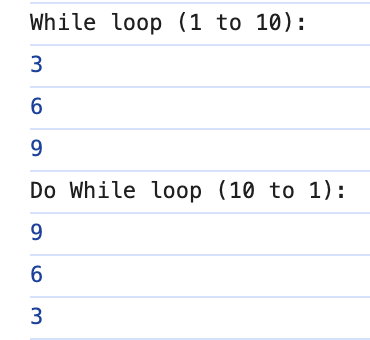

3.  Resolve previous exercise using an alternative approach with two `for` loops.
    - Console Output:
    
    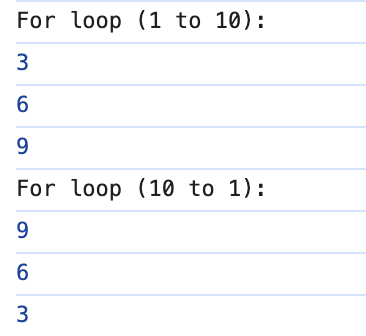

4.  To understand the difference between **function scope** and **block scope**, add the following function to the `basic.js` file and call the `testScope()` function.

```js
// Exercise 4: Function scope and block scope
function testScope() {
  console.log("testing Scope");
  var x = 1;
  let y = 2;
  const z = 3;

  if (true) {
    var x = 4;
    let y = 5;
    const z = 6;
    var newX = 7;
    let newY = 8;
    const newZ = 9;
    console.log(x, y, z);
    console.log(newX, newY, newZ);
  }

  console.log(x, y, z);
  console.log(newX);
  console.log(newY);
  console.log(newZ);
}
```

- Add console.log statements in other locations to better observe the program's behavior; for example, copy `console.log(x, y, z)` to the beginning of the if block.

- Analyze the code and the execution results (console output), and then answer the following questions:

    1.  Variables created with var statements are available anywhere in the function (function scope) or only available inside the block (block scope) they were created?

    2.  Variables created with let statements are available anywhere in the function (function scope) or only available inside the block (block scope) they were created?

    3.  Constant (const statements) are available anywhere in the function (function scope) or only available inside the block (block scope) they were created?

    4.  Variables created with var statements can be redeclared (new variable with the same name) on the same scope (yes or no)?

    5.  Variables created with let statements can be redeclared (new variable with the same name) on the same scope (yes or no)?

    6.  Constant (const statements) can be redeclared (new const with the same name) on the same scope (yes or no)?
        - Fill up the following table:

    |           | **Variable or Constant** | **Scope (function or block)** | **Redeclaration (yes or no)** |
    | --------- | ------------------------ | ----------------------------- | ----------------------------- |
    | **var**   |                          |                               |                               |
    | **let**   |                          |                               |                               |
    | **const** |                          |                               |                               |

    7.  **Block scope** is **safer** and **more predictable**. Taking that fact into consideration, which statements (var, let, const) should be used to create variables and constants?

5.  JavaScript includes the following primitive types: `string`; `number`; `bigint`; `boolean`; `null` and `undefined`. When expressions combine values of different types, JavaScript automatically performs an implicit type conversion --- known as **coercion**. The results of coercion can sometimes be unexpected. In this exercise, we will analyze several examples of coercion using arithmetic operators (`+, - , \*, /`) applied to different primitive types, as well as to objects and arrays.
    - Add the functions `getTypeStringOf()` and `testCoercion()` with the following code:

```js
function getTypeStringOf(value) {
  let type = typeof value;
  if (type === "object") {
    type = Array.isArray(value) ? "array" : value === null ? "null" : "object";
  }
  return type;
}

function testCoercion(left, right, operator = "+") {
  let result;
  try {
    switch (operator) {
      case "+":
        result = left + right;
        break;
      case "-":
        result = left - right;
        break;
      case "*":
        result = left * right;
        break;
      case "/":
        result = left / right;
        break;
      case "===":
        result = left === right;
        break;
      case "!==":
        result = left !== right;
        break;
      case "==":
        result = left == right;
        break;
      case "!=":
        result = left != right;
        break;
      case "??":
        result = left ?? right;
        break;
      case "||":
        result = left || right;
        break;
    }
    console.log(`\
${left} (${getTypeStringOf(left)})\
${operator} \
${right} (${getTypeStringOf(right)}) = \
${result} (${getTypeStringOf(result)})`);
  } catch (e) {
    console.log(`\
${left} (${getTypeStringOf(left)})\
${operator} \
${right} (${getTypeStringOf(right)}) = \
Error: ${e.message}`);
  }
}
```

- Test previous function with the following code.

```js
console.clear();
testCoercion(2, 1, "+");
testCoercion("2", 1, "+");
testCoercion(1, "2", "+");
testCoercion("a", 1, "+");
testCoercion(2, 1, "-");
testCoercion(1, "2", "-");
testCoercion("2", 1, "-");
testCoercion("a", 1, "-");
```

- Check the console output generated by the `testCoercion()` function on previous code.

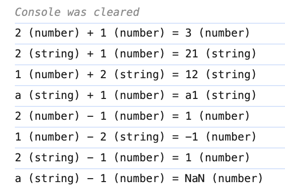

- Analyze the results and answer the following questions:

    1.  Is the **+** operator used for number addition, string concatenation, or both?

    2.  Is the **-** operator used for number subtraction, string manipulation, or both?

    3.  What happens when the **+** operator is applied to a number and a string?

    4.  What happens when the **-** operator is applied to a number and a string? How does this differ from the behavior of the **+** operator?

    5.  The result of the expression **`"a" - 1`** is **NaN**. What is the type of **NaN** value and why is it the result of the expression?

- Also, analyze the code of `getTypeStringOf()` function and answer the following questions:

    6.  What is the purpose of the typeof operator in JavaScript, and what value and type does it return?

    7.  Why is there specific code section to return the type "array" and "null"?

- Analyze the code of `testCoercion()` function and answer the following questions:

    8.  The function `testCoercion()` uses template literal strings (multiline strings defined by the backtick character `` ` `` that supports interpolation). What is the role of `\` and `${...}`?

    9.  The function `testCoercion()` includes a try catch block. Why?
- Add the following array (named values) containing a set of values to be tested. Each value will be used as the left operand and combined with every other value as the right operand.

    ```js
    let values = [
      "a",
      "1",
      0,
      3,
      3.14,
      4n,
      true,
      false,
      null,
      undefined,
      [6, "7"],
      { a: 1 },
    ];
    ```

    - Note that 4n is a bigint.
- Add the following array (named operators) containing the list of operators to test.

    ```js
    let operators = ["+", "-", "*", "/"];
    ```

- Add the required code to combine all values with all operators. Use for .. on loops, or array.forEach callback to implement that code.
- Execute the combination code (all operator combined with all values) and complete the following tables (one table per operator):

    10. Complete the table for the `+` operator and analyze the results.

    | **left:**     | **'a'** | **'1'** | **0** | **3** | **3.14** | **4n** | **true** | **false** | **null** | **undefined** | **[6, '7']** | **{a: 1}**         |
    | ------------- | ------- | ------- | ----- | ----- | -------- | ------ | -------- | --------- | -------- | ------------- | ------------ | ------------------ |
    | **'a'**       | 'aa'    | 'a1'    | 'a0'  | 'a3'  | 'a3.14'  | 'a4'   | 'atrue'  | 'afalse'  | 'anull'  | 'aundefined'  | 'a6,7'       | 'a[object Object]' |
    | **'1'**       | '1a'    | '11'    | '10'  | '13'  | '13.14'  | '14'   | '1true'  | '1false'  | '1null'  | '1undefined'  | '16,7'       | '1[object Object]' |
    | **0**         | '0a'    | '01'    | 0     | 3     | 3.14     | Error  | 1        | 0         | 0        | NaN           | '06,7'       | '0[object Object]' |
    | **3**         |         |         |       |       |          |        |          |           |          |               |              |                    |
    | **3.14**      |         |         |       |       |          |        |          |           |          |               |              |                    |
    | **4n**        |         |         |       |       |          |        |          |           |          |               |              |                    |
    | **true**      |         |         |       |       |          |        |          |           |          |               |              |                    |
    | **false**     |         |         |       |       |          |        |          |           |          |               |              |                    |
    | **null**      |         |         |       |       |          |        |          |           |          |               |              |                    |
    | **undefined** |         |         |       |       |          |        |          |           |          |               |              |                    |
    | **[6, '7']**  |         |         |       |       |          |        |          |           |          |               |              |                    |
    | **{a: 1}**    |         |         |       |       |          |        |          |           |          |               |              |                    |

    11. Explain the results of the following expressions by researching their causes online `0+4n`; `0+true`, `0+false`, `0+null`, `0+undefined`, `0+[6, '7']`.

    12. The result of this operation `(3+3.14)` is `6.140000000000001`. Why?

    13. Complete the table for the `-` operator and analyze the results.

    | **left:**     | **'a'** | **'1'** | **0** | **3** | **3.14** | **4n** | **true** | **false** | **null** | **undefined** | **[6, '7']** | **{a: 1}** |
    | ------------- | ------- | ------- | ----- | ----- | -------- | ------ | -------- | --------- | -------- | ------------- | ------------ | ---------- |
    | **'a'**       | NaN     |         |       |       |          |        |          |           |          |               |              |            |
    | **'1'**       | NaN     | 0       | 1     | -2    | -2.14    | Error  | 0        | 1         | 1        | NaN           | NaN          | NaN        |
    | **0**         |         |         |       |       |          |        |          |           |          |               |              |            |
    | **3**         |         |         |       |       |          |        |          |           |          |               |              |            |
    | **3.14**      |         |         |       |       |          |        |          |           |          |               |              |            |
    | **4n**        |         |         |       |       |          |        |          |           |          |               |              |            |
    | **true**      |         |         |       |       |          |        |          |           |          |               |              |            |
    | **false**     |         |         |       |       |          |        |          |           |          |               |              |            |
    | **null**      |         |         |       |       |          |        |          |           |          |               |              |            |
    | **undefined** |         |         |       |       |          |        |          |           |          |               |              |            |
    | **[6, '7']**  |         |         |       |       |          |        |          |           |          |               |              |            |
    | **{a: 1}**    |         |         |       |       |          |        |          |           |          |               |              |            |

    14. Complete the table for the `*` operator and analyze the results.

    | **left:**     | **'a'** | **'1'** | **0** | **3** | **3.14** | **4n** | **true** | **false** | **null** | **undefined** | **[6, '7']** | **{a: 1}** |
    | ------------- | ------- | ------- | ----- | ----- | -------- | ------ | -------- | --------- | -------- | ------------- | ------------ | ---------- |
    | **'a'**       | NaN     |         |       |       |          |        |          |           |          |               |              |            |
    | **'1'**       | NaN     | 1       | 0     | 3     | 3.14     | Error  | 1        | 0         | 0        | NaN           | NaN          | NaN        |
    | **0**         |         |         |       |       |          |        |          |           |          |               |              |            |
    | **3**         | NaN     | 3       | 0     | 9     | 9.42     | Error  | 3        | 0         | 0        | NaN           | NaN          | NaN        |
    | **3.14**      |         |         |       |       |          |        |          |           |          |               |              |            |
    | **4n**        |         |         |       |       |          |        |          |           |          |               |              |            |
    | **true**      |         |         |       |       |          |        |          |           |          |               |              |            |
    | **false**     |         |         |       |       |          |        |          |           |          |               |              |            |
    | **null**      |         |         |       |       |          |        |          |           |          |               |              |            |
    | **undefined** |         |         |       |       |          |        |          |           |          |               |              |            |
    | **[6, '7']**  |         |         |       |       |          |        |          |           |          |               |              |            |
    | **{a: 1}**    |         |         |       |       |          |        |          |           |          |               |              |            |

    15. Complete the table for the `/` operator and analyze the results.

    | **left:**     | **'a'** | **'1'** | **0**    | **3** | **3.14** | **4n** | **true** | **false** | **null** | **undefined** | **[6, '7']** | **{a: 1}** |
    | ------------- | ------- | ------- | -------- | ----- | -------- | ------ | -------- | --------- | -------- | ------------- | ------------ | ---------- |
    | **'a'**       | NaN     |         |          |       |          |        |          |           |          |               |              |            |
    | **'1'**       | NaN     | 1       | Infinity |       |          |        | 1        | Infinity  | Infinity |               |              |            |
    | **0**         | NaN     | 0       | NaN      |       |          |        |          |           |          |               |              |            |
    | **3**         |         |         | Infinity |       |          |        |          |           |          |               |              |            |
    | **3.14**      |         |         |          |       |          |        |          |           |          |               |              |            |
    | **4n**        |         |         |          |       |          |        |          |           |          |               |              |            |
    | **true**      |         |         |          |       |          |        |          |           |          |               |              |            |
    | **false**     |         |         |          |       |          |        |          |           |          |               |              |            |
    | **null**      |         |         |          |       |          |        |          |           |          |               |              |            |
    | **undefined** |         |         |          |       |          |        |          |           |          |               |              |            |
    | **[6, '7']**  |         |         |          |       |          |        |          |           |          |               |              |            |
    | **{a: 1}**    |         |         |          |       |          |        |          |           |          |               |              |            |

    16. Analyzing the behavior of the values: true, false, null and undefined in the previous 4 tables, what values do they assume when the operator expects a number?
        - true is converted to the value **1**
        - false is converted to the value **\_\_**
        - null is converted to the value **\_\_**
        - undefined is converted to the value **\_\_**

    17. The expressions: '1'/0 and 3/0, both return infinity, and 0/0 returns NaN. Why does this happen? Also, take note that JavaScript has two number values that are not common among other languages, the NaN value and the infinity value. On most languages, what happens when these expressions: '1'/0; 3/0 and 0/0 are processed?

6.  JavaScript provides strict equality (===) and strict inequality (!==) operators. To analyze and compare them with loose equality (==) and loose inequality (!=), use the same approach as in the previous exercise. Combine the following values with each operator: '1', 1, 1.0, 0, true, false, null

    1.  Complete the table for the strict equality operator (`===`) and analyze the results.

    | **left:** | **'1'** | **1** | **1.0** | **0** | **true** | **false** | **null** |
    | --------- | ------- | ----- | ------- | ----- | -------- | --------- | -------- |
    | **'1'**   | true    | false | false   | false | false    | false     | false    |
    | **1**     | false   | true  | true    | false | false    | false     | false    |
    | **1.0**   | false   | true  | true    | false | false    | false     | false    |
    | **0**     |         |       |         |       |          |           |          |
    | **true**  |         |       |         |       |          |           |          |
    | **false** |         |       |         |       |          |           |          |
    | **null**  |         |       |         |       |          |           |          |

    2.  Complete the table for the loose equality operator (`==`) and analyze the results.

    | **left:** | **'1'** | **1** | **1.0** | **0** | **true** | **false** | **null** |
    | --------- | ------- | ----- | ------- | ----- | -------- | --------- | -------- |
    | **'1'**   | true    | true  | true    | false | true     | false     | false    |
    | **1**     | true    | true  | true    | false | true     | false     | false    |
    | **1.0**   | true    | true  | true    | false | true     | false     | false    |
    | **0**     |         |       |         |       |          |           |          |
    | **true**  |         |       |         |       |          |           |          |
    | **false** |         |       |         |       |          |           |          |
    | **null**  |         |       |         |       |          |           |          |

    3.  Complete the table for the strict inequality operator (`!==`) and analyze the results.

    | **left:** | **'1'** | **1** | **1.0** | **0** | **true** | **false** | **null** |
    | --------- | ------- | ----- | ------- | ----- | -------- | --------- | -------- |
    | **'1'**   | false   | true  | true    | true  | true     | true      | true     |
    | **1**     | true    | false | false   | true  | true     | true      | true     |
    | **1.0**   | true    | false | false   | true  | true     | true      | true     |
    | **0**     |         |       |         |       |          |           |          |
    | **true**  |         |       |         |       |          |           |          |
    | **false** |         |       |         |       |          |           |          |
    | **null**  |         |       |         |       |          |           |          |

    4.  Complete the table for the loose inequality operator (`!=`) and analyze the results.

    | **left:** | **'1'** | **1** | **1.0** | **0** | **true** | **false** | **null** |
    | --------- | ------- | ----- | ------- | ----- | -------- | --------- | -------- |
    | **'1'**   | false   | false | false   | true  | false    | true      | true     |
    | **1**     | false   | false | false   | true  | false    | true      | true     |
    | **1.0**   | false   | false | false   | true  | false    | true      | true     |
    | **0**     |         |       |         |       |          |           |          |
    | **true**  |         |       |         |       |          |           |          |
    | **false** |         |       |         |       |          |           |          |
    | **null**  |         |       |         |       |          |           |          |

7.  JavaScript includes the nullish coalescing operator (`??`), which provides a default value (right operand) when the left operand is null or undefined. The logical OR operator (`||`) can behave similarly, but it considers all falsy values instead of only null or undefined. To compare both operators, use an approach similar to the previous exercises, but vary only the left operand. The right operand will always be the string "default". The left operand values to test are defined by the following array:

```js
let values3 = [
  true,
  false,
  null,
  undefined,
  1,
  1.0,
  1n,
  0,
  0.0,
  -0,
  0n,
  NaN,
  Infinity,
  "",
  " ",
  "a",
  "1",
  "0",
  [],
  [2],
  {},
  { a: 1 },
];
```

  1.  Analyze the results for the table for both operators (?? and ||).

  | **left:**     | left `?? 'default'` | left `\|\| 'default'` |
  | ------------- | ------------------- | --------------------- |
  | **true**      | true                | true                  |
  | **false**     | false               | **'default'**         |
  | **null**      | **'default'**       | **'default'**         |
  | **undefined** | **'default'**       | **'default'**         |
  | **1**         | 1                   | 1                     |
  | **1.0**       | 1                   | 1                     |
  | **1n**        | 1n                  | 1n                    |
  | **0**         | 0                   | **'default'**         |
  | **0.0**       | 0                   | **'default'**         |
  | **-0**        | 0                   | **'default'**         |
  | **0n**        | 0n                  | **'default'**         |
  | **NaN**       | NaN                 | **'default'**         |
  | **Infinity**  | Infinity            | Infinity              |
  | **''**        | ''                  | **'default'**         |
  | **' '**       | ' '                 | **' '**               |
  | **'a'**       | 'a'                 | 'a'                   |
  | **'1'**       | '1'                 | '1'                   |
  | **'0'**       | '0'                 | '0'                   |
  | **[ ]**       | [ ]                 | [ ]                   |
  | **[2]**       | [2]                 | [2]                   |
  | **{ }**       | { }                 | { }                   |
  | **{ a:1}**    | { a:1}              | { a:1}                |

  2.  Analyze the results of the expression left || "default". Identify which values are falsy - that is, values that evaluate to
  false in a boolean context.

  **false**, **\_\_\_\_\_\_\_\_\_\_\_\_\_\_\_\_\_\_\_\_\_\_\_\_\_\_\_\_\_**

8.  In JavaScript, all numeric values (integers and real numbers) were originally of type number. The bigint type was only introduced in ES2020 (ES11). This creates some challenges when dealing specifically with integers. Implement three functions that handle integers but rely only on numbers (do not use bigint).
    - validateInteger(str) -- checks if the string str represents a valid integer. It should reject values that JavaScript would normally coerce into numbers (e.g., " 23", "12.3" or " 12abc ") and only accept _"clean"_ integers. Returns the integer as a number if valid, or null otherwise.

    - numberDivision(n1, n2) -- writes on the console the result of the division n1 / n2 -- result is a real number.

    - integerDivision(n1, n2) -- writes on the console the integer quotient and remainder of the division n1 / n2. Both n1 and n2 should be treated as integers. For example, if n1 = 7.1 and n2 = 2.8, the division should be performed as 7 / 2, yielding a quotient of 3 and a remainder of 1.

    - To implement the previous functions, the JavaScript native functions parseInt and Math.trunc may be useful.
    1.  Test previous functions. Try these two divisions: 6.9 / 2.3 and 7.1 / 3.8 with both numberDivision and integerDivision functions. It should write the following on the console:

    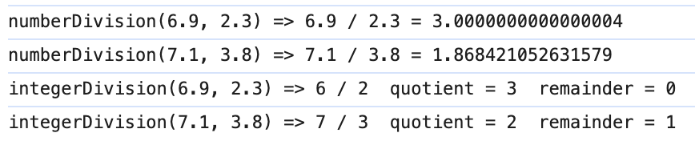
    - Note that the value of the division 6.9/2.3 loses precision when handled as a real number.

## Arrays

### Arrow functions and functional programming

In this section, we will explore arrays. Also, from this point on, we will use only **arrow functions** (instead of the classic function syntax). When working with arrays, we will apply both the imperative approach and the functional programming approach (using array methods that take callbacks).

9.  For this section, we will use the page `array.html` and create a new JavaScript file named `array.js` inside the `js` folder. Add a reference to this new file (`array.js`) in `array.html`, but do not remove the existing reference to tables.js.

10. To ensure that everything is working as expected, add the following code to the newly created file (`array.js`):

```js
showArrayOnTable("data-table-1", [1, 2, 3, 4, 5, 6, 7, 8, 9, 10]);
```

- Open the page array.html on the browser. It should display the following content:

  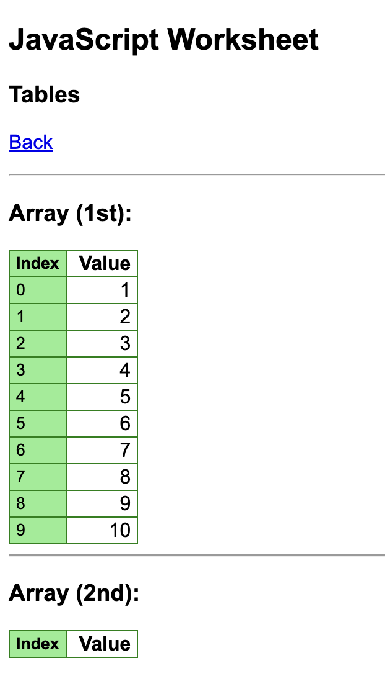

- The `showArrayOnTable` function in the `tables.js` file is responsible for displaying a representation of an array on the HTML page. Review its code briefly -- it relies on DOM methods to manipulate the contents of the `<table>` element on the page.

11. Implement a function (assigned to the const `buildArrayOfIntegers`) using arrow function syntax. This function should return a new array containing a predefined number of elements. The array elements must be integer numbers, generated either sequentially or randomly. Use the following structure as a starting point:

```js
const buildArrayOfIntegers = (total, random = false, min = 1, max = 100) => {
  // if random is false, it will return an array of integers from (min) to (total + min - 1)
  // e.g., buildArrayOfIntegers(5) => [1, 2, 3, 4, 5]
  // e.g., buildArrayOfIntegers(5, false, 3) => [3, 4, 5, 6, 7]

  // if random is true, it will return an array of random integers
  // between min and max (inclusive) -
  // e.g., buildArrayOfIntegers(5, true, 1, 10) => [3, 7, 1, 9, 4]

  . . .

  return array
}
```

- Use array.push() to add elements to the array, Math.floor() or Math.trunc() to ensure the values are integers, and Math.random() to generate random numbers.

- Test the function with the provided examples (in the comments) as well as your own. Display the results with showArrayOnTable() and with different console methods: console.log(), console.dir(), and console.table().

- Check the output of buildArrayOfIntegers(5). Compare the display formats produced by console.log(), console.dir(), and console.table() in the console.

  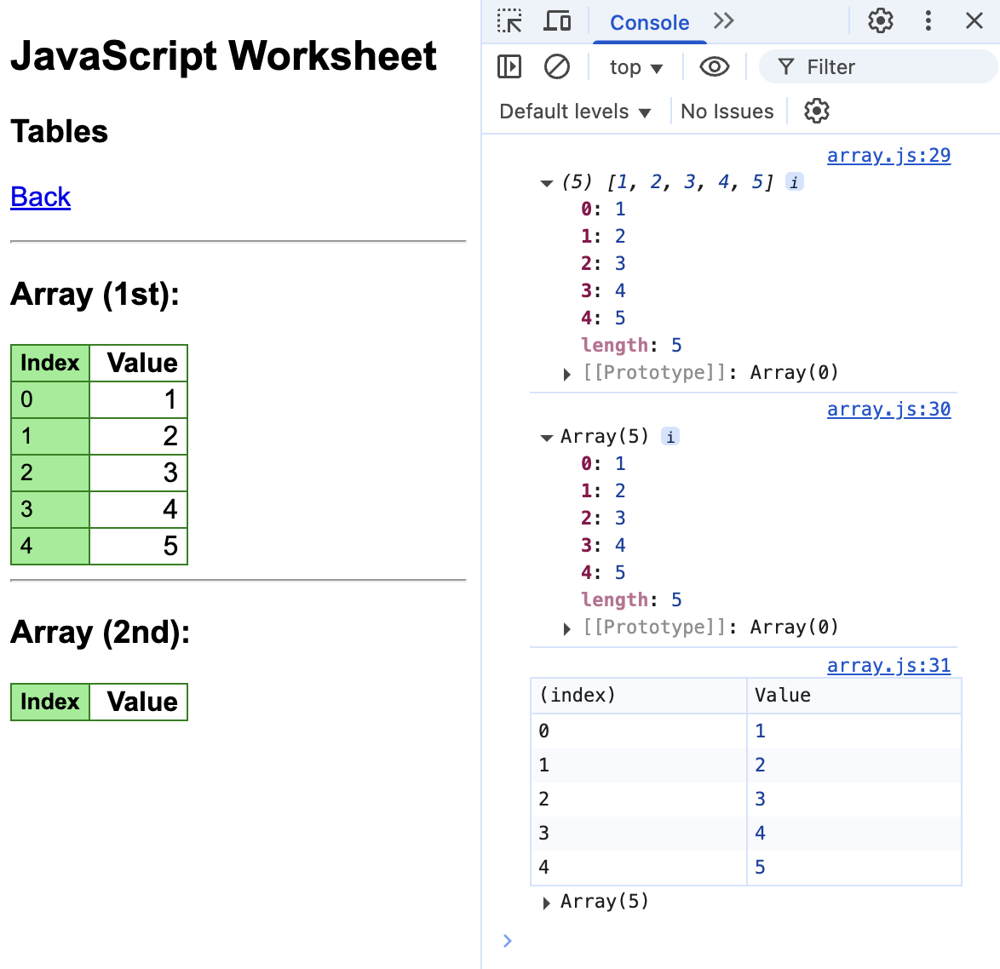

12. Create an array with 100 random integers (random values between 0 and 20). Perform the following operations on this array. Write the results on the page and the console and analyze them.
    - To solve these exercises, you may use the array property length, functions such as `push()`, `unshift()`, `pop()`, `shift()`, `join()`, `indexOf()`, `lastIndexOf()`, `slice()`, `concat()`,and `splice()` and the spread syntax applied to arrays: [. . . array]. For more details, consult the [MDN Array documentation](https://developer.mozilla.org/docs/Web/JavaScript/Reference/Global_Objects/Array).
    1.  Add the element "Z" to the end of the array.
    2.  Add the element "A" to the start of the array.
    3.  Remove the element at the third position (index 2).
    4.  Print on the console the size of the array (at this point, it should be 101).

    5.  Print on the console the value of the last element and remove it from the array.

    6.  Print on the console the value of the first element and remove it from the array.

    7.  Convert the array into a string with the following formats:
        - "2,5,7,23,4,3,8,..."
        - "2, 5, 7, 23, 4, 3, 8, ..."
        - "2 -- 5 -- 7 -- 23 -- 4 -- 3 -- 8 -- ..."

    8.  Print on the console the index of the first element whose value is 20.
        - Test with the following values: 20, '20', 23 and 0.
    9.  Print on the console the index of the last element whose value is 20.
        - Test with the following values: 20, '20', 23 and 0.
    10. Create three new arrays with content copied from the original:
        - one with 10 elements starting at index 5,
        - one with 5 elements starting at index 30,
        - one with 10 elements starting at index 80.
        Show the original array and these three copies in the console.

    11. Create a new array that merges the three arrays above (25 elements in total). Print the merged array and the arrays used.
        - Implement two versions: one using concat() function and another using the **spread syntax** (e.g., [...array1, ...array2])

    12. Create a new array identical to the original (with random numbers between 0 and 20) but with only 20 elements. Replace 5 elements starting at the index 3 with the elements 'a', 'b', 'c'.

        Note: this removes 5 elements and replaces them with 3 elements, reducing the array size from 20 to 18.

    13. From the previous array (which now has 18 elements), delete 7 elements starting at index 4. The new size should be 11.

13. The file array.html already includes a reference to students.js, so you can use the functions defined in that file. Taking this into account, create an array with 100 random student objects and display it on the page by adding the following code to the array.js file:

```js
showArrayOnTable("data-table-2", []);
let arrStudents = createArrayOfStudents(100);
showArrayOnTable("data-table-1", arrStudents);
```

- Review the students.js file and provide a brief analysis of its code.
- Content of the page should be similar to:

  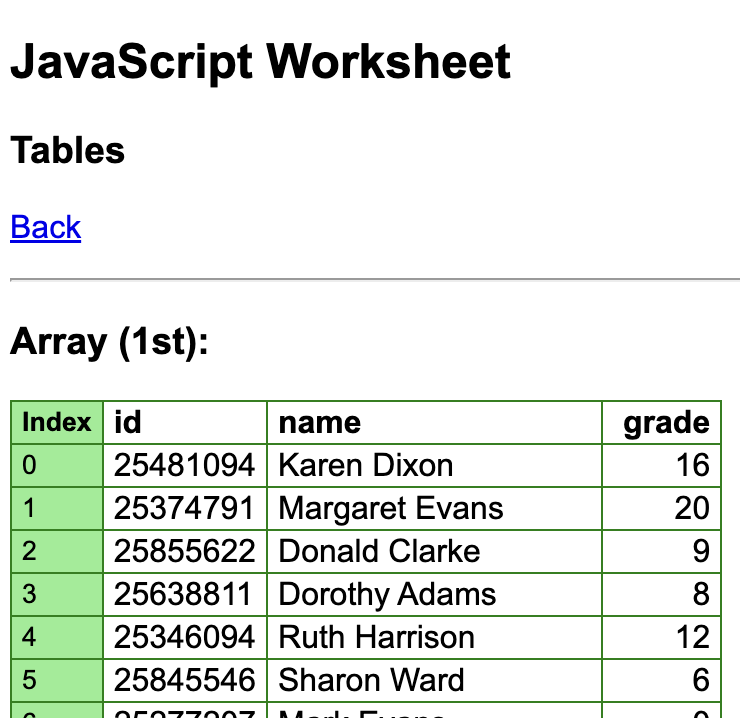

14. Find the index of the first student in the array whose grade is a given value.
    - Note: You cannot use the native array function indexOf(), because you don't have the full object to search for --- only the grade value. You will need to search for it manually.
    1.  Create a function, assigned to the constant findFirstIndexByGrade1, that accepts an array of students and a grade. The function should return the index of the first student whose grade matches the given value, or -1 if no match is found.
        Implement this solution using a traditional for loop: `for (let i = 0; i < array.length; i++)`

    2.  Create a function, assigned to the constant findFirstIndexByGrade2, that accepts an array of students and a grade. The function should return the index of the first student whose grade matches the given value, or -1 if no match is found. In this solution, use a functional programming style by passing a callback to the **`findIndex()`** function.

15. Find the first student in the array whose grade matches a given value and return the student object (instead of the index).
    1.  Create a function, assigned to the constant findFirstByGrade1 that accepts an array of students and a grade. The function should return the student object whose grade matches the given value, or null if no student is found. In this solution, use a traditional for loop: `for (let i = 0; i < array.length; i++)`

    2.  Create a function, assigned to the constant findFirstByGrade2 that accepts an array of students and a grade. The function should return the student object whose grade matches the given value, or null if no student is found. In this solution, use a functional programming style by passing a callback to the **`find()`** function.

16. Create a new array by filtering the original student's array. The filtered array should include all students with a given grade (instead of stopping at the first match). Show the original and thefiltered array on the web page.
    1.  Create a function, assigned to the constant filterByGrade1 that accepts an array of students and a grade. The function should return an array of students whose grade matches the given value, or an empty array if no matches are found. In this solution, use a traditional for loop: `for (let i = 0; i < array.length; i++)`

    2.  Create a function, assigned to the constant filterByGrade2 that accepts an array of students and a grade. The function should return an array of students whose grade matches the given value, or an empty array if no matches are found. In this solution, use a functional programming style by passing a callback to the
        **`filter()`** function.

17. Using only the **`filter()`** function, and applying the same principle as the previous exercise (but without creating additional functions, other than the callbacks passed to filter), create the following filtered arrays variables:
    1.  approved -- all students with grade ≥ 10
    2.  notApproved -- all students with grade < 10

18. <a id="_Ref209095818"></a>Using the reduce() function, calculate the
    average grade of:
    - all students
    - approved students
    - not approved students
      - For reference, see the [MDN Array.reduce documentation](https://developer.mozilla.org/docs/Web/JavaScript/Reference/Global_Objects/Array/reduce).
    - Create a function, assigned to the constant average that accepts an array. Inside this function, use reduce() to calculate the sum of all grades in the array, then divide the result by the total number of elements.

    - Use the previously created approved and notApproved arrays as the basis for calculating the averages for those groups.

19. <a id="_Ref209096005"></a>The previous solution works correctly but requires executing the reduce() function three times and running filter() twice to obtain the approved and notApproved arrays. We can optimize performance by calculating all three sums and counts in a single pass.
    - Instead of initializing the accumulator with a number (0), initialize it with an object containing all the properties needed for the calculations, and use that object as the accumulator.

    - One possible solution is shown below (assuming arrStudents is the array of all students)

```js
const averageOptimizedFunction = (array) => {
  let initialValue = {
    counterApproved: 0,
    sumApproved: 0,
    avgApproved: 0,
    counterNotApproved: 0,
    sumNotApproved: 0,
    avgNotApproved: 0,
    counterAll: 0,
    sumAll: 0,
    avgAll: 0,
  };

  const result = array.reduce((acc, student) => {
    if (student.grade >= 10) {
      acc.counterApproved++;
      acc.sumApproved += student.grade;
    } else {
      acc.counterNotApproved++;
      acc.sumNotApproved += student.grade;
    }
    return acc;
  }, initialValue);

  result.avgApproved = result.sumApproved / result.counterApproved;
  result.avgNotApproved = result.sumNotApproved / result.counterNotApproved;
  result.counterAll = result.counterApproved + result.counterNotApproved;
  result.sumAll = result.sumApproved + result.sumNotApproved;
  result.avgAll = result.sumAll / result.counterAll;

  return result;
};

averageOptimized = averageOptimizedFunction(arrStudents);
console.log("Average grade of all students:", averageOptimized.avgAll);
console.log(
  "Average grade of approved students:",
  averageOptimized.avgApproved,
);
console.log(
  "Average grade of notApproved students:",
  averageOptimized.avgNotApproved,
);
```

- Test the solution and analyze the code.

- **Note:** this solution is more complex than the previous one. Only use this approach if performance is a concern --- in most cases, the earlier, cleaner solution is preferable.

20. To compare the performance of both solutions, create an array with one million students - createArrayOfStudents(1000000) - and use the following functions to measure the execution time of a code block:
    - console.time(str_label) -- starts a timer with the specified label.

    - console.timeEnd(str_label) -- stops the timer with the same label and outputs to the console the elapsed time in milliseconds.

    - Steps:
      - Create the array with one million students: createArrayOfStudents(1000000)

      - For the first version of the reduce exercise ([18](#_Ref209095818)), include in the timer the filtering operations (for approved and notApproved array) as well as the three reduce() operations used to calculate the averages.

      - For the second version of the reduce exercise ([19](#_Ref209096005)) -- averageOptimizedFunction - include in the timer only the execution of the function call, since the reduce() logic is optimized and executed in a single pass.

    - The console output should be like the following. Also, the performance difference between the two approaches will be of the same order of magnitude, with the second solution being roughly three or four times faster.

      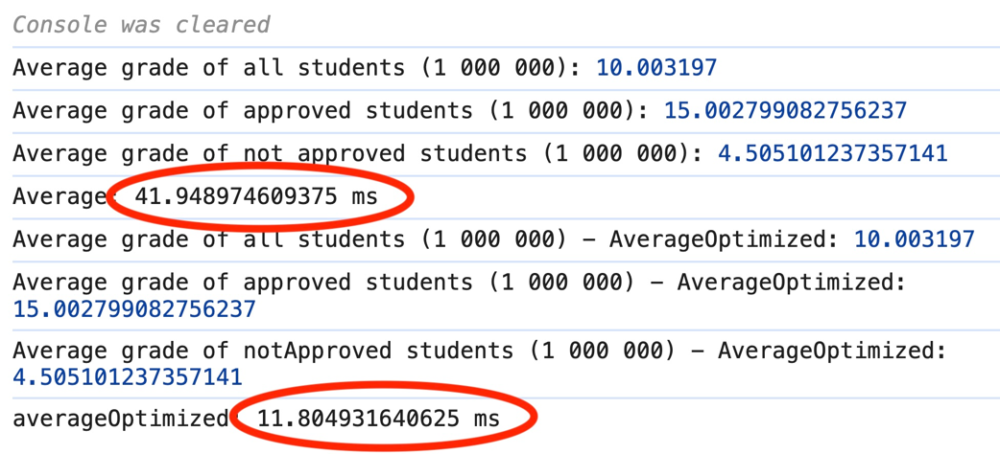

21. Using the sort() function with a comparison callback, create a new array of students sorted by grade, with the highest grades first.

    For reference, see the [MDN Array.sort documentation](https://developer.mozilla.org/docs/Web/JavaScript/Reference/Global_Objects/Array/sort).
    - Applying sort() directly to arrStudents will modify the original array (arrStudents). To preserve both the original and the sorted array, create a copy using the **spread syntax** **`[...arrStudents]`**.

22. The map() function is used to transform arrays. It creates a new array in which each element is the result of applying a callback to the corresponding element of the original array. The callback receives one element of the original array at a time and returns the transformed element to be added to the new array.

    Using the map() function, transform the original array of students into a new array where each student object includes an additional property, "status", whose value is either 'approved' or 'not approved', depending on the student's grade. 
    - For reference, see the [MDN Array.map documentation](https://developer.mozilla.org/docs/Web/JavaScript/Reference/Global_Objects/Array/map).

    - Ensure that the original array remains unchanged by creating copies of the objects within the map callback, rather than using direct references to the original objects.

    - The transformed array should be displayed on the page and should resemble the following format:

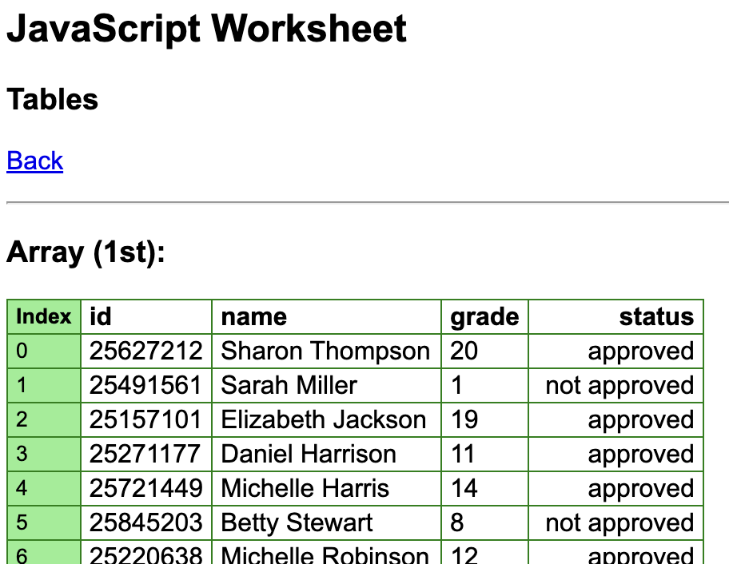

## Objects

On this section we'll explore JavaScript objects, namely: object literals; object references; creating and cloning objects; prototypes and extending objects.

23. Create a file named objects.js inside the js folder and add a reference to it in objects.html. In this section (Objects) all code should be implemented in objects.js and executed through objects.html.

24. <a id="_Ref209193203"></a>Create an object using an object literal with three properties (firstName, lastName, and dateOfBirth) and two methods: fullName() and age(). The code to create this object is:

```js
const person = {
  firstName: "John",
  lastName: "Doe",
  dateOfBirth: new Date(1995, 8, 20), // September 20, 1995 (month starts at 0)

  fullName: function () {
    return `${this.firstName} ${this.lastName}`;
  },

  age: function () {
    const today = new Date();
    let age = today.getFullYear() - this.dateOfBirth.getFullYear();
    let deltaM = today.getMonth() - this.dateOfBirth.getMonth();
    if (
      deltaM < 0 ||
      (deltaM === 0 && today.getDate() < this.dateOfBirth.getDate())
    ) {
      age--;
    }
    return age;
  },
};
```

- An object literal is not a class---it is already an instance.

- Inside a method defined with standard function syntax (as is the case), **this** keyword refers to the object instance.

- However, when a method is defined using arrow function syntax - (...) => { ... } -, **this** does not bind to the object instance; it retains the value from the surrounding lexical context.

25. Test the person object with the following code:

```js
console.clear();
console.log(person.fullName());
console.log(person.age());
person.lastName = "Smith";
console.log(person.fullName());
```

- This is the result of previous code:

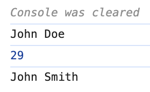

- Note that although the person object is declared with const---meaning the variable binding cannot be reassigned to another value or object---the properties of the object (e.g., lastName) can still be modified. In other words, the reference held by person is immutable, but the contents of the referenced object remain mutable.

- It is also possible to display a simple object on the page by calling the showObjectOnTable function (defined as a const in the tables.js file). Try this code:

  ```js
  showObjectOnTable("data-table-1", person);
  ```

  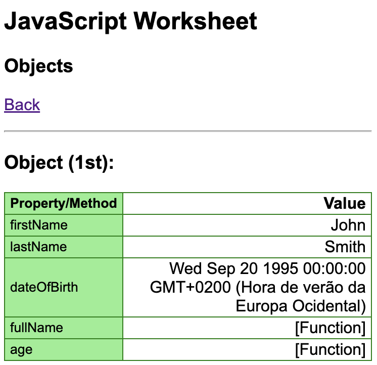

26. Implement a function and assign it to the constant randomPersonFactory, that returns an object instance for a random person (with random names and date of birth).
    - The file students.js provides two constants, englishFirstNames and englishLastNames, which should be used to assign random values to the first name and last name properties. Analyze the code in this file (students.js), as it contains examples relevant to this exercise.

    - Use the code of exercise ([24](#_Ref209193203)) as a reference when designing the solution for this exercise. In particular, copy the implementation of the fullName and age methods.

    - Use the following code to generate a random date:

```js
new Date(
  Math.floor(Math.random() * 87) + 1920, // 1920 to 2006
  Math.floor(Math.random() * 12), // month 0-11
  Math.floor(Math.random() * 28) + 1,
); // day 1-28 (for simplicity)
```

- Test the function by outputting the result to the console using the following alternatives:
  - console.log()
  - console.dir()
  - console.table()

- Compare the output formats of these three console methods.

  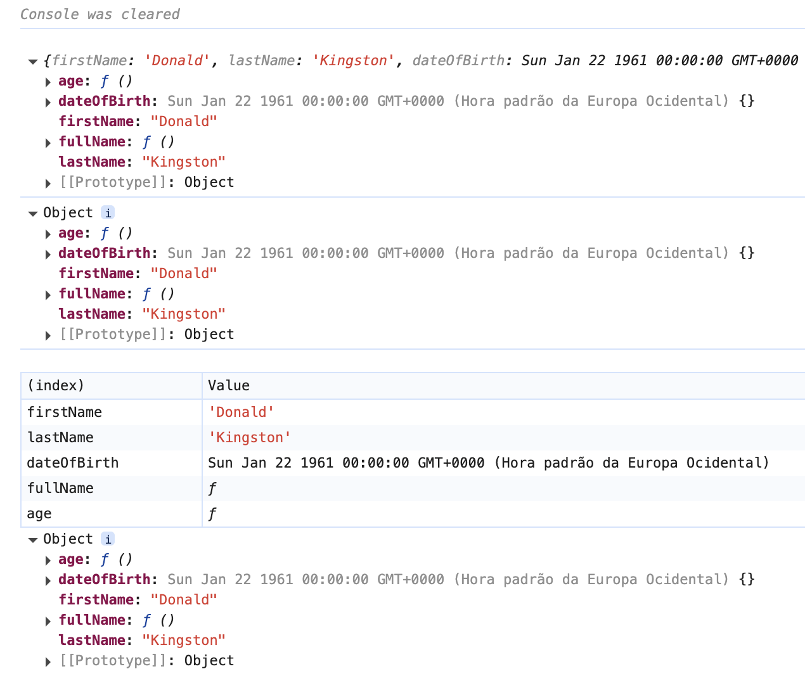

27. Besides using object literals, it is also possible to create object instances with constructor functions or by copying/cloning existing
    objects.
    - In this course we will not use constructor functions, as their use has become increasingly rare in modern JavaScript codebases.

    - Implement two functions that each accept an object (person) and return a shallow copy of that object. The returned value should be a new object instance with the same properties and methods as the original.
    1.  Assign the first function to the constant clonePersonWithSpread. This function should use the object spread operator to copy the object: `let copyObj = { ...originalObject }`

    2.  Assign the second function to the constant clonePersonWithAssign. This function should use the  Object.assign method to copy the object: `let copyObj = Object.assign({}, originalObject)`
        - Note that Object.assign does not create a new instance in the sense of a constructor or class. It copies the properties of the second object (originalObject) into the first object (usually a new empty object {}). As a result, the "new object" is simply the empty object {} with the copied properties added.

      - Using the console, execute both functions and compare their results to the original person object (a random person passed to both functions). Compare references and content across the three objects: the original and the two copies.

    3.  Is there any difference between an object copied with the spread operator and an object copied with the Object.assign method?

28. <a id="_Ref209270444"></a>The previous exercise implemented a shallow copy, meaning that only the first-level properties and methods are duplicated. Properties that are nested objects or arrays are not fully copied; instead, their references are preserved. As a result, the original and the copied object share the same nested
    structures.
    - In this exercise, we will analyze this behavior and observe the consequences of using a shallow copy.
    - Copy the following code and execute it:

```js
const personB = randomPersonFactory();

personB.contacts = {
  email: `${personB.firstName.toLowerCase()}.${personB.lastName.toLowerCase()}@example.com`,
  phone: "923 843 343",
};

personB.children = [`Richard ${personB.lastName}`, `Mary ${personB.lastName}`];

const copiedPersonB1 = clonePersonWitSpread(personB);
const copiedPersonB2 = clonePersonWithAssign(personB);

console.clear();
console.log("personB", personB);
console.log("copiedPersonB1", copiedPersonB1);
console.log("copiedPersonB2", copiedPersonB2);
```

- Check the console output and verify that the nested object contacts and the array children appear to have the same values in all three objects (personB, copiedPersonB1, and copiedPersonB2). This happens because they all share the same reference---the reference stored in the original object (personB).

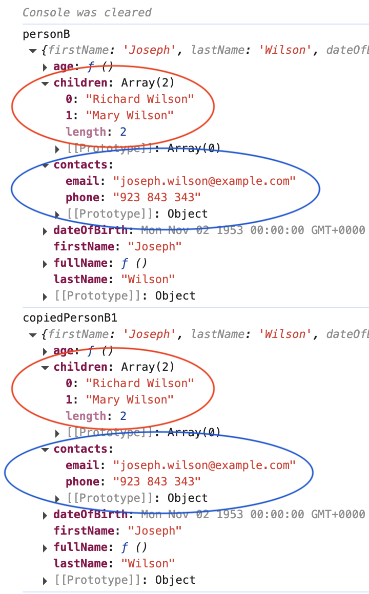

- Add the following code that proves that copied objects are referencing the same nested object and arrays on the original object.

```js
personB.contacts.phone = "910 000 000";
personB.firstName = "João";
personB.children.push("Daniel Oliveira");

console.log("personB", personB);
console.log("copiedPersonB1", copiedPersonB1);
console.log("copiedPersonB2", copiedPersonB2);
```

- Analyze the output:

  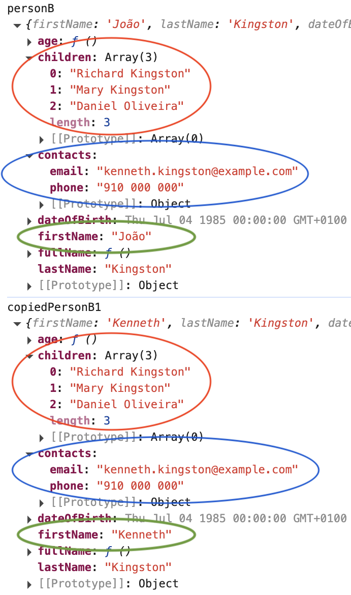

    1.  The children array and the contacts nested object have the same values in all three objects (the original and the two copies). Why does this happen?

    2.  The value of the firstName property in the original object (personB) is different from the value of the same property in the copies. Why is this the case? What is the difference between this property (firstName) and the children array or the contacts object?

29. <a id="_Ref209364729"></a>When a shallow copy is not sufficient, it is possible to create a **deep copy**. A deep copy duplicates not only the first-level properties but also the contents of nested objects and arrays, ensuring that the copy is completely independent from the original. Common approaches for deep copies in JavaScript
    include:
    - `structuredClone(obj)` -- a modern built-in method (ES2021) that performs a true deep copy for most object types.

    - `JSON.parse(JSON.stringify(obj))` -- a traditional workaround that deep-copies data but only works reliably for JSON-safe values (it discards functions, Date, Map, Set, etc.).

    - Utility libraries (e.g., Lodash's cloneDeep) -- widely used in projects for robust deep copying across many data types.
    1.  Create a new random person (personC) that includes a contacts object and a children array (similar to the previous exercise). Then, create a deep copy of this object using the structuredClone function.

    ```js
    console.clear();

    const personC = randomPersonFactory();

    personC.contacts = {
      email: `${personC.firstName.toLowerCase()}.${personC.lastName.toLowerCase()}@example.com`,
      phone: "923 843 343",
    };

    personC.children = [`Charles ${personC.lastName}`, `Ann ${personC.lastName}`];

    const deepCopiedPerson = structuredClone(personC);
    ```

    - When executing previous code, the following error happens:

      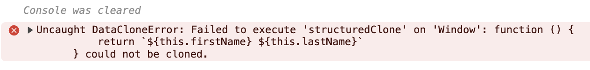

    - This error occurs because structuredClone cannot clone objects that contain functions.

    2.  <a id="_Ref209276622"></a>Change previous code so that personC don't have any functions - properties age and fullName are set to undefined:

    ```js
    console.clear();

    const personC = randomPersonFactory();

    personC.contacts = {
      email: `${personC.firstName.toLowerCase()}.${personC.lastName.toLowerCase()}@example.com`,
      phone: "923 843 343",
    };

    personC.children = [`Charles ${personC.lastName}`, `Ann ${personC.lastName}`];

    personC.age = undefined;
    personC.fullName = undefined;

    const deepCopiedPerson = structuredClone(personC);
    ```

    3.  Test the deep copy created on previous exercise ([29.2](#_Ref209276622)) in a similar context to exercise [28](#_Ref209270444). Compare the outcome when using a shallow copy to using a deep copy.
        - Note: code to test the deep copy:

    ```js
    console.clear();

    console.log("personC", personC);
    console.log("deepCopiedPerson", deepCopiedPerson);

    personC.contacts.phone = "900 000 00";
    personC.firstName = "Manuela";
    personC.children.push("Cristina Oliveira");

    console.log("personC", personC);
    console.log("deepCopiedPerson", deepCopiedPerson);
    ```

    - Output result (last 2 console.log statements):

      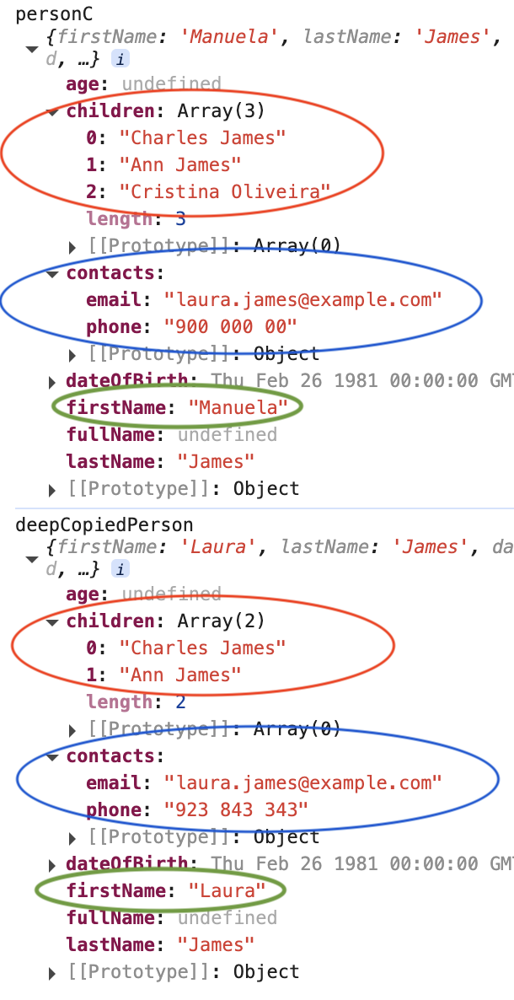

    4.  When you modify the first-level property (firstName), the nested object (contacts), or the array (children) of the original object (personC), what happens to the corresponding properties in a previously created deep copy? Why? What happens when you perform the same changes on a shallow copy?

    5.  There are at least three disadvantages of deep copies (created with structuredClone) compared to shallow copies: performance overhead, higher memory usage, and the inability to copy functions. Explain each disadvantage and provide scenarios where these limitations are especially relevant.
    - Summary of shallow vs deep copies differences:
      - Shallow copy is faster and lighter but risks hidden coupling through shared references.

      - Deep copy costs more (performance, memory) but ensures isolation, safety, and predictability, especially in stateful or nested data structures.

30. <a id="_Ref209364732"></a>Up until this exercise, we have created new objects using object literals and by creating copies (shallow or deep) of existing objects. Another approach is to **create new objects** using an **existing object as a prototype**. In this case, instead of copying the original object's properties, the new object inherits from the original object's prototype. This behavior is implemented using the Object.create() method.
    1.  Create the object person, that will be used as the prototype, with the following code:

    ```js
    console.clear();

    const personD = randomPersonFactory();

    personD.contacts = {
      email: `${personD.firstName.toLowerCase()}.${personD.lastName.toLowerCase()}@example.com`,
      phone: "910 111 222",
    };

    personD.children = [`Pedro ${personD.lastName}`, `Dany ${personD.lastName}`];
    ```

    2.  Create a new object from the prototype of the personD object using Object.create(). Output both personD and the newly created object to the console.

    ```js
    const newPersonD = Object.create(personD);

    console.log("personD", personD);
    console.log("newPersonD", newPersonD);
    ```

    - Output console:

    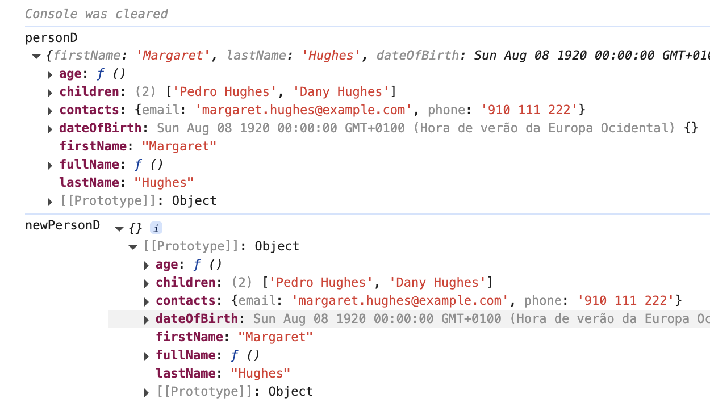

    - Note that the **prototype** of the new object (newPersonD) refers to the object personD. The properties are not copied; instead, the new object inherits from personD via its prototype.

    3.  Execute the following sequence of code and analyze the console output.

    ```js
    console.clear();
    console.log("personD.firstName", personD.firstName);
    console.log("newPersonD.firstName", newPersonD.firstName);

    personD.firstName = "Beatriz";
    console.log("personD.firstName", personD.firstName);
    console.log("newPersonD.firstName", newPersonD.firstName);

    newPersonD.firstName = "Rita";
    console.log("personD.firstName", personD.firstName);
    console.log("newPersonD.firstName", newPersonD.firstName);

    console.log("personD", personD);
    console.log("newPersonD", newPersonD);
    ```

    - The console output:

    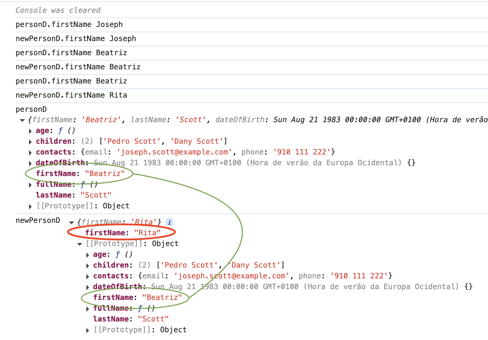

    - Note that when you access the firstName property of newPersonD for the first time, it retrieves the value from the prototype, because newPersonD does not yet have its own firstName property.

    - If the firstName property of personD changes, this change is reflected in newPersonD as well, because the prototype of newPersonD is a reference to the personD object. Any updates to personD are visible through the prototype chain.

    - When newPersonD assigns a value to firstName, it creates its own property, even though the prototype has a property with the same name. When an object and its prototype chain contain properties with the same name, JavaScript first accesses the property on the object itself. If it doesn't exist there, it looks up the property on the
      prototype, then on the prototype's prototype, and continues up the chain until it finds a match or reaches the end.

    4.  Create an array with one hundred new object instances based on the personD prototype. Then, add the property middleName to the personD object. Use console output to demonstrate that all the new objects automatically have access to this property through the prototype.

    5.  Compare Object.create (which creates a new object using a prototype) with Object.assign or the spread operator (which creates a shallow copy). Which approach consumes less memory? Explain why.

    6.  Compare the two approaches to creating objects --- using shallow copies (Object.assign or the spread operator) versus the prototype-based approach (Object.create). Identify the main advantages and disadvantages of each.

31. <a id="_Ref209367882"></a>One of the advantages of the prototype-based approach is that it reduces memory usage. However,sharing state (data properties) across multiple objects is usually undesirable. In practice, objects of the same type (e.g., Person) should share the same methods, while their data should remain instance specific. A common JavaScript pattern is therefore to create new objects that inherit methods from a prototype but maintain their own data.
    - The function createObjFrom(object, overrides = {}) implements this pattern. It creates a new object that inherits from the prototype of the given object and copies its data properties (deep copy) into the new instance. The second argument allows overriding any of these properties with custom values or adding new properties.
    - Note that this function only works correctly if the nested properties do not contain functions.

```js
function createObjFrom(object, overrides = {}) {
  // Step 1: Create a new object whose prototype is object
  const newObj = Object.create(object);

  // Step 2: Copy (shallow) all *own, non-function* properties from object into newObj
  for (const [key, value] of Object.entries(object)) {
    if (typeof value !== "function") {
      newObj[key] = structuredClone(value);
    }
  }

  // Step 3: Apply overrides (custom data)
  Object.assign(newObj, overrides);

  return newObj;
}
```

- Use the function createObjFrom to create six new objects from an original person object and add them to an array. Assign a custom value for the firstName and lastName property of at least one of these objects. Use the console to examine the content of the original person and the newly created objects.

```js
const originalPerson = randomPersonFactory();
const people = [];

for (let i = 0; i < 5; i++) {
  people.push(createObjFrom(originalPerson));
}

people.push(createObjFrom(originalPerson, { lastName: "Smith" }));
people[4].firstName = "Alice";

console.clear();
console.log("originalPerson", originalPerson);
console.log("people[3]", people[3]);
console.log("people[4]", people[4]);
console.log("people[5]", people[5]);
console.log("people", people);

showObjectOnTable("data-table-1", originalPerson);
showObjectOnTable("data-table-2", people[4]);
```

- The result (on the console and on the page) for previous code:

  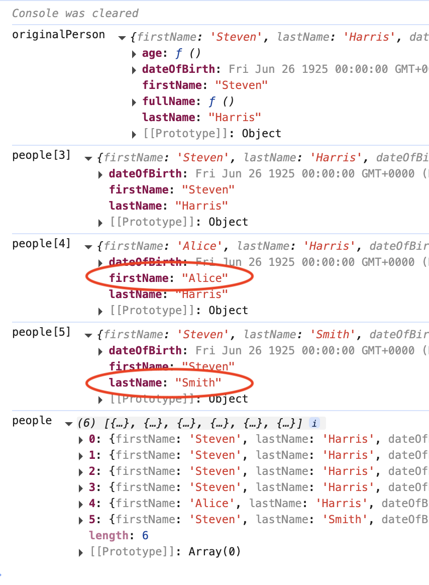 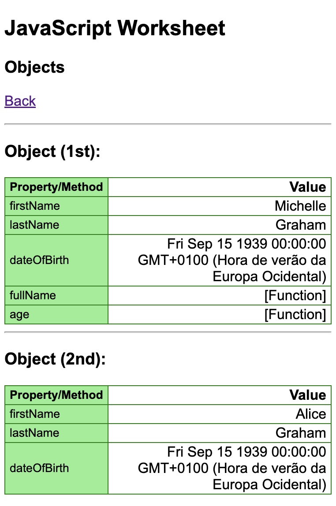

- Analyze the results of the given code. Compare this approach to creating objects using Object.create. What are the main differences between these approaches?

32. JavaScript objects are conceptually simple: at their core, they are just collections of key--value pairs, very similar to hash tables. Creating objects is also much more flexible, since they can be defined using object literals or by copying from other objects. There is no requirement for a fixed template such as a class.

    **Extending objects** is equally straightforward. In class-based languages, extending behavior typically requires creating a new class that inherits from an existing one. In JavaScript, extending an object can be as simple as adding, updating, or removing properties (whether data properties or methods), either on the object itself or on its prototype.
    1.  In exercises [28](#_Ref209270444), [29](#_Ref209364729) and [30](#_Ref209364732), we wrote several code snippets where objects were extended. Identify the sections where new properties were added and where properties were removed.

    2.  To create a student object, start by generating a person using the function randomPersonFactory(). Then extend this object with the following additional properties:
        - id -- the student's unique identifier.
        - course -- the name of the student's course.
        - disciplines -- an array of objects, where each object represents a discipline with a name and a grade (between 10 and 20). A null grade indicates that the student has not yet passed that discipline. The file students.js already includes an array of discipline names (disciplineNames) that can be used.
        - averageGrade -- a function (method) that calculates and returns the student's average grade across all disciplines where the student is approved (grade !== null).
        - Test previous exercise using the console output -- analyze the results.

    3.  Create an array with two students, based on the previously defined student object. Use the function createObjFrom (implemented in exercise [31](#_Ref209367882)). Modify the firstName property of the second student in the array and update the grade of that student's first discipline. Output the results to the console and analyze the outcome. Code:

```js
const studentsArray = [];

for (let i = 0; i < 2; i++) {
  studentsArray.push(createObjFrom(student));
}

console.clear();
console.log(student);
console.log(studentsArray[1].disciplines[0].grade);

studentsArray[1].firstName = "Ann";
studentsArray[1].disciplines[0].grade = 20;

console.log(studentsArray);
```

- The console output:

  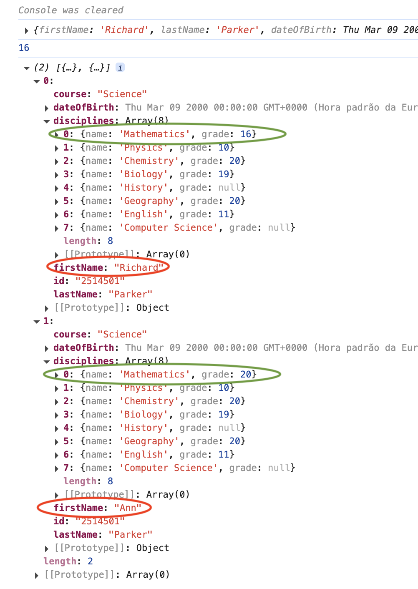

- Note that the firstName property and the first element of the disciplines array differ between the two students. Also, the disciplines arrays themselves have different values because the createObjFrom function uses structuredClone to create a deep copy of arrays and objects.

33. **Optional exercise** - As we have seen in the JavaScript object exercises, the object paradigm in JavaScript differs from the more traditional class-based paradigm commonly used in languages such as C++, Java, C#, PHP, Python, and many others. However, because many developers are more familiar with the class-based paradigm, the **class syntax** was introduced in ECMAScript 2015 (ES6).
    - JavaScript's class syntax introduces the class keyword and a formalized way to define inheritance.
    - However, this is **syntactic sugar** over JavaScript's existing prototype-based inheritance. The underlying inheritance mechanism in JavaScript remains prototype based, not classical like in Java or C#.
    1.  Create a new file named class.js in the js folder and add a reference to it in the object.html file.

    2.  Replicate the previous exercise (32) using class syntax. Create a Person class and a Student subclass with the same properties and methods as those used in exercise 32.

    3.  Using these classes, write code to perform the same tests as in exercise 32.

    4.  Analyze the results using the console output and compare them to the results of exercise 32.
        - Note that all methods of the classes are on the prototype chain, while all data properties are own properties of each object.

## Functions

On this section we'll explore JavaScript functions, namely: classic and arrow functions; anonymous functions; immediately invoked function expressions; callbacks and closures.

34. Create a file named functions.js inside the js folder and add a reference to it in function.html. In this section (Functions) all code should be implemented in functions.js and executed through functions.html.

35. JavaScript supports three common approaches for defining functions:
    - Function Declaration - function foo() {} - (classic syntax, named function).

    - Function Expression - const foo = function () {} - (classic syntax, anonymous function).

    - Arrow Function Expression - const foo = () => {} - (arrow syntax, anonymous function).
    1.  Implement functions that add two numbers using each of the three approaches. Test them by printing the function definition or expression and the execution result to the console.

36. Functions in JavaScript can be defined using either the classic function syntax or the arrow function syntax. Arrow functions are always anonymous, so they can only be used as function expressions. This does not affect their basic execution; the only important internal difference between these two types of functions concerns the handling of the this keyword.
    - **Arrow functions** - this keyword is lexically bound; it keeps the value of this from the surrounding scope and does not create its own.
    - **Classic functions** - this changes depending on how the function is called. Inside an object method, it usually refers to the object. If the function is called in another way, this will point to whatever context made the call (for example, the global object in non-strict mode, or undefined in strict mode).

      To illustrate the difference, we will use the following three examples and analyze their behavior:
    1.  Create an object with three methods: the first two using classic function syntax and the third using arrow function syntax. Execute all three methods and analyze the console output to observe the behavior of this.

    ```js
    const obj = {
      name: "Alice",
      age: 30,

      greet: function () {
        return `Hello, my name is ${this.name} and I am ${this.age} years old.`;
      },

      farewell() {
        return `Goodbye from ${this.name}!`;
      },

      greetAgain: () => {
        return `Hello again from ${this.name}, I'm ${this.age} years old!`;
      },
    };

    console.clear();
    console.log(obj.greet());
    console.log(obj.farewell());
    console.log(obj.greetAgain());
    ```

    - The output should look similar to the following:

      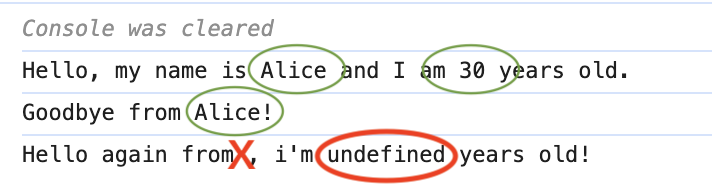

    - The third method (using an arrow function) does not display correctly the name and age properties. Why does this happen? To understand add the console.log(this) to the methods code:

    ```js
    const obj = {
      name: "Alice",
      age: 30,

      greet: function () {
        console.log(this);
        return `Hello, my name is ${this.name} and I am ${this.age} years old.`;
      },

      farewell() {
        console.log(this);
        return `Goodbye from ${this.name}!`;
      },

      greetAgain: () => {
        console.log(this);
        return `Hello again from ${this.name}, I'm ${this.age} years old!`;
      },
    };

    console.clear();
    console.log(obj.greet());
    console.log(obj.farewell());
    console.log(obj.greetAgain());
    ```

    - The output should look similar to the following:

      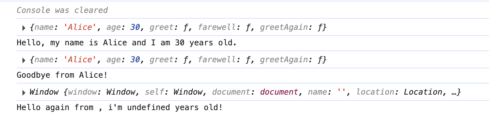

    - Note: In the two classic functions of the object, this refers to the object itself, whereas in the arrow function (greetAgain), this refers to the Window object (the global browser window). By coincidence, the Window object has a name property with an empty string as its value, which is why this.name outputs "". However, it does not have an age property, so this.age evaluates to undefined.

    2.  Create three global functions: the first two using classic function syntax and the third using arrow function syntax. Execute all three methods and analyze the console output to observe the behavior of this reference.

    ```js
    function globalTest1() {
      console.log(this);
    }

    const globalTest2 = () => {
      console.log(this);
    };

    const globalTest3 = () => {
      console.log(this);
    };

    console.clear();
    globalTest1();
    globalTest2();
    globalTest3();
    ```

    - The output should look similar to the following:

    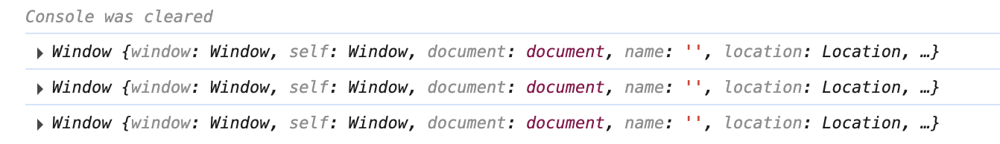

    - In the global context, the value of this inside any function is the same: it refers to the Window object (the global browser window).

    - Small nuance: that statement is only true in non-strict mode. In strict mode, this in a global function declaration is undefined. To observe this nuance, add the following line of code to the beginning of the JavaScript file:

    ```js
    "use strict";
    ```

    - The reference for this in the global function definition (named globalTest1) is now undefined

      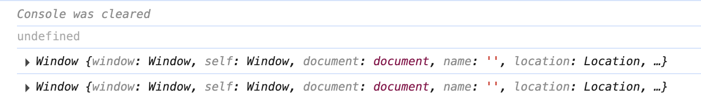

    3.  In a more complex scenario, create an object with a method (using classic syntax). Inside this method, use the map function on an array with a callback. Implement two versions: in the first, the callback is an arrow function; in the second, the callback is a classic function.

    ```js
    const student = {
      id: "20250323",
      name: "John Smith",
      course: "Computer Science",
      grades: [
        { discipline: "Mathematics", grade: 8 },
        { discipline: "Physics", grade: 12 },
        { discipline: "English", grade: 14 },
        { discipline: "Programming 1", grade: 18 },
      ],

      reportGrade1() {
        return this.grades.map(
          (item) =>
            this.id +
            " | " +
            this.name +
            " | " +
            item.discipline +
            " | " +
            item.grade,
        );
      },

      reportGrade2() {
        return this.grades.map(function (item) {
          return (
            this.id +
            " | " +
            this.name +
            " | " +
            item.discipline +
            " | " +
            item.grade
          );
        });
      },
    };

    console.clear();
    console.log(student.reportGrade1());
    console.log(student.reportGrade2());
    ```

    - If we are using the strict mode ("use strict";), the output should look similar to the following:

    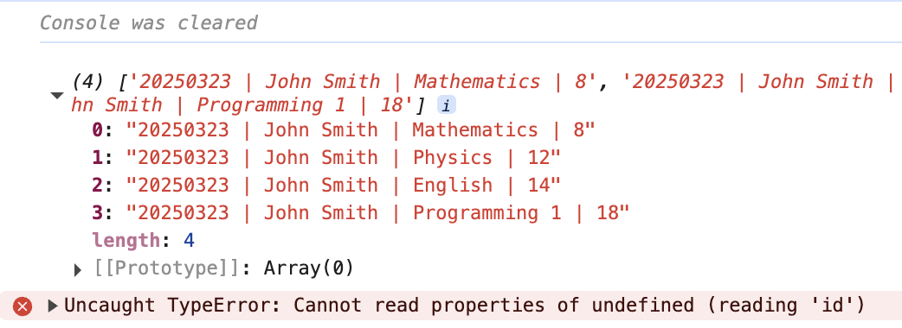

    - If we are using the non-strict mode (without "use strict";), the output should look similar to the following:

      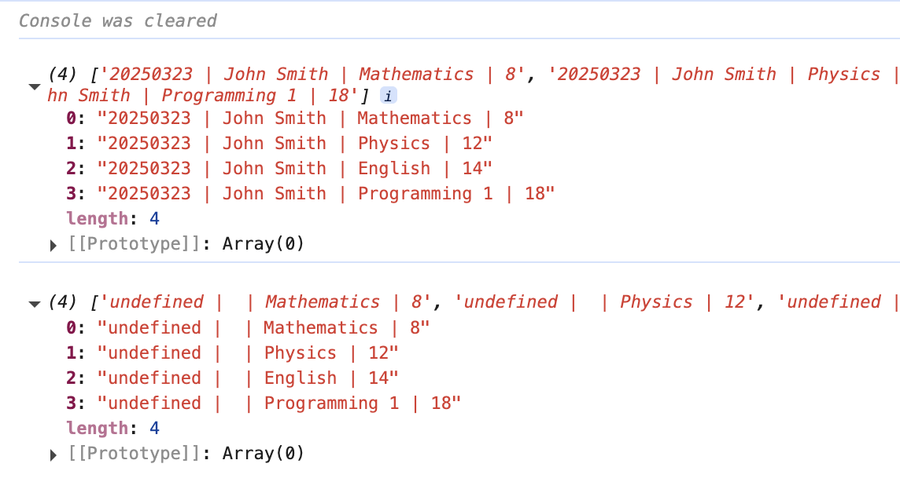

    - The first method (reportGrade1) works correctly: it transforms the array of grades into an array of strings, where each string includes the id, name, discipline, and grade. The second method (reportGrade2) fails: in strict mode it throws an error, and in non-strict mode it returns undefined for id and name. Why?
      - Both reportGrade1 and reportGrade2 are classic syntax functions and methods of the student object. Inside these methods, this refers to the student object, so we can access this.grades, this.id, this.name, and this.course.

      - However, the callback passed to the map function is its own function, separate from the outer method (reportGrade1 or reportGrade2). It's this callback that generates each report string and tries to use this.id and this.name. In the first case (reportGrade1), the callback is an arrow function, so it gets the value of this from its surrounding context (the student object). In the second case (reportGrade2), the callback is a classic function, which does not retain the outer this; instead, the reference to this is dynamically bound (to undefined in strict mode, or to the global Window object in non-strict mode).

      - To confirm this behavior, add a console.log(this) statement inside each callback function.

    - **Recommendation for function syntax and consistency**:
      - Use **classic** function declarations for **object methods**.

        ```js
        obj = {
          // . . .
          method() {
            // . . .
          },
          // . . .
        };
        ```

      - Use **arrow** functions for all **other cases**.

37.  In the previous examples, function expressions (whether classic functions or arrow functions) were always assigned to a constant, variable, or object property. This approach allows anonymous functions to be accessed later via the assigned reference. However, function expressions can also be immediately invoked inline without assigning them to any reference.
  - Try the following code, which includes two constants assigned to functions and two constants assigned to results of invoking functions:
  ```js
  const sqr1 = function (x) {
    return x ** 2;
  };
  const sqr2 = (x) => x ** 2;
  const sqr3 = (function (x) {
    return x ** 2;
  })(3);
  const sqr4 = ((x) => x ** 2)(4);
  console.clear();
  console.log(typeof sqr1, " | ", sqr1);
  console.log(typeof sqr2, " | ", sqr2);
  console.log(typeof sqr3, " | ", sqr3);
  console.log(typeof sqr4, " | ", sqr4);
  ```
  - The output should look similar to the following:
    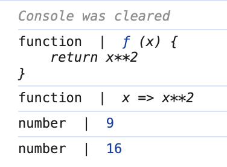
  - Analyze the code and the console output. The constants sqr1 and sqr2 reference functions, while sqr3 and sqr4 hold the results of invoking those functions (the numeric values 9 and 16). Functions are invoked inline when followed by the **call operator ()**, which may include arguments to be passed to the function.

38.  Analyze the following expressions and indicate what is the value of the constant a. Try to get the result before testing it with code.

| **ID** | **Expression**                                                             | **value of a** |
| ------ | -------------------------------------------------------------------------- | -------------- |
| 38.1   | const a = ( a ) => a + 3                                                   | function       |
| 38.2   | const a = ((a) => a + 3)(5)                                                | 8              |
| 38.3   | const a = ((a) => a + 3)(a => 'A')()                                       | Error          |
| 38.4   | const a = ((a) => a + 3)((() => 'A')())                                    | 'A3'           |
| 38.5   | let b = 5<br>const a = ((b) => a + 3)(b)                                   |                |
| 38.6   | let b = 5<br>const a = ((a) => b + 3)(b + 2)                               |                |
| 38.7   | let b = 5<br>const a = ((a) => a + 3)(() => b + 1 )                        |                |
| 38.9   | let b = 5<br>const a = ((a) => a + 3)(((a) => a \* 2 )(b))                 |                |
| 38.9   | let b = 5<br>const a = ((a) => a + 3)(((a) => a \* 2 )(((x) => x - 1)(b))) |                |

39.  A **callback** is a function passed as an argument to another function, to be executed later by that function. This mechanism is widely used in JavaScript, both in functional programming patterns and in handling asynchronous operations. In previous exercises, we have already made extensive use of callbacks. The following code sections illustrate examples of callbacks, with the callback function highlighted below:

```js
    const notApproved = arrStudents.filter((student) => student.grade < 10);
    // . . .
    const average = (array) => {
      const total = array.reduce((acc, student) => acc + student.grade, 0);
      return total / array.length;
    };
```
  - While the first callback accepts one argument, the second accepts two. Why? The function that receives the callback---called a **higher-order function** (a function that takes another function as an argument or returns a function)---determines which arguments to provide. In these examples, the higher-order functions filter and reduce are responsible for invoking the callback and supplying the arguments they choose. When using higher-order functions, we can pass our own callback, but its structure must match what the higher-order function expects.

  - This is a common misconception for beginners: they often try to adapt the callback's arguments to their specific problem. This is not possible---the callback's arguments are predetermined by the higher-order function and cannot be changed.

40.  Most real-world JavaScript projects just use pre-existing higher-order functions, such as map, filter, reduce, and forEach, with custom callback functions. While less common, we can also define our own higher-order functions to abstract patterns, delegate complexity to the callback, and improve extensibility, allowing the code to handle future or unknown rules. In this exercise, we will illustrate how a higher-order function can delegate complexity to the callback and make the application adaptable to future, unknown rules.
      1. First, try the following code, which defines the averageGrade method to calculate a student's average course grade using only pre-existing higher-order functions:
```js
const student2 = {
  id: "20250323",
  name: "John Smith",
  course: "Computer Science",
  grades: [
    { discipline: "Mathematics", grade: 10 },
    { discipline: "Analysis", grade: null },
    { discipline: "Physics", grade: 8 },
    { discipline: "English", grade: 14 },
    { discipline: "Programming 1", grade: 18 },
  ],

  averageGrade() {
    const initialValue = {
      weightedSum: 0,
      totalWeight: 0,
    };

    const total = this.grades.reduce((acc, item) => {
      if (item.grade === null || item.grade === undefined) {
        return acc;
      }
      acc.weightedSum += item.grade;
      acc.totalWeight++;
      return acc;
    }, initialValue);

    return total.weightedSum / total.totalWeight;
  },
};

console.clear();
console.log("Average Grade: " + student2.averageGrade());
```

- The output should look similar to the following:

    

- The function (averageGrade) for calculating the average grade ignores null grades and computes the average of the remaining grades. However, we may want to also ignore negative grades (< 10) and assign different weights to different disciplines in different courses.

- One solution would be to add extra data to the object and modify the code to account for these new rules.

- Instead, we will transform the averageGrade function into a higher-order function that accepts a callback. This callback will return the weight of a specific discipline or null if the  discipline's grade should be ignored. We don't need to define any specific rules about discipline weights upfront --- that responsibility is delegated to the callback.

- We can also maintain the default calculation by checking whether a callback is provided to averageGrade. If no callback is passed, the function will perform the same calculation as before.
  
  2. Copy the previous student2 object as student3 and modify the averageGrade method to become a higher-order function that takes the
        points discussed above into consideration. The full code for the
        student3 object is as follows:

    ```js
    const student3 = {
      id: "20250323",
      name: "John Smith",
      course: "Computer Science",
      grades: [
        { discipline: "Mathematics", grade: 10 },
        { discipline: "Analysis", grade: null },
        { discipline: "Physics", grade: 8 },
        { discipline: "English", grade: 14 },
        { discipline: "Programming 1", grade: 18 },
      ],

      averageGrade(weightCallback) {
        const initialValue = {
          weightedSum: 0,
          totalWeight: 0,
        };

        const total = this.grades.reduce((acc, item) => {
          if (!weightCallback) {
            // no weightCallback provided:
            if (item.grade === null || item.grade === undefined) {
              return acc;
            }
            acc.weightedSum += item.grade;
            acc.totalWeight++;
            return acc;
          } else {
            // weightCallback provided:
            const weight = weightCallback(item, this.course);
            if (weight === null || weight === undefined || weight <= 0) {
              return acc;
            }
            acc.weightedSum += item.grade * weight;
            acc.totalWeight += weight;
            return acc;
          }
        }, initialValue);

        return total.weightedSum / total.totalWeight;
      },
    };
    ```

    3.  Test the modified averageGrade method by using it without any callback (the calculation will remain the same as before) and with two alternative callbacks. The first callback ignores negative grades (< 10), while the second callback ignores negative grades and also applies specific weights: doubling the weight of "mathematics" and tripling the weight of "programming1" if the student's course is "Computer Science".

    ```js
    console.clear();

    // No Weight Callback: Default calculation
    const average1 = student3.averageGrade();
    console.log("Average Grade 1: " + average1);

    // Weight Callback Example: Ignore negative grades
    // weight = 1 otherwise
    const average2 = student3.averageGrade((disc) => (disc.grade >= 10 ? 1 : null));
    console.log("Average Grade 2: " + average2);

    // Weight Callback Example: Ignore negative grades and
    // double weight (weight = 2) for "Mathematics" (all courses)
    // triple weight (weight = 3) for "Programming 1" if course is "Computer Science"
    // weight = 1 otherwise
    const average3 = student3.averageGrade((disc, course) => {
      if (disc.grade < 10) return null;
      if (disc.discipline === "Mathematics") return 2;
      if (course === "Computer Science" && disc.discipline === "Programming 1")
        return 3;
      return 1;
    });
    console.log("Average Grade 3: " + average3);

    // Same callback as average3 but changing the course to "Civil Engineering"
    // This will change the weight for "Programming 1" to 1
    student3.course = "Civil Engineering";

    const average4 = student3.averageGrade((disc, course) => {
      if (disc.grade < 10) return null;
      if (disc.discipline === "Mathematics") return 2;
      if (course === "Computer Science" && disc.discipline === "Programming 1")
        return 3;
      return 1;
    });
    console.log("Average Grade 4: " + average4);
    ```

  - Note that the callback accepts two arguments --- the discipline and
      the course. However, in the first example, only one argument is used,
      while in the second example, both arguments are used. This behavior is
      due to a JavaScript characteristic that allows a mismatch between the
      number of arguments passed during invocation and the number of
      parameters defined in the function. In this case, the higher-order
      function calls the callback with two arguments, but the first callback
      ignores the second argument.
    - This does not mean that we can arbitrarily define our own arguments
        on a callback. It simply means that a callback can choose to ignore
        some of the arguments provided by the higher-order function.

  - The output should look similar to the following:

    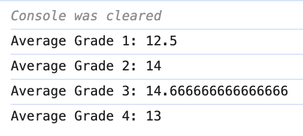

  - Analyze the code of the averageGrade method and the callbacks used, as well as their effect on the resulting output.

  - This solution for averageGrade is more complex than the initial version but is far more customizable and easily extensible.

41. Another functional programming concept that is very useful is the **closure**. A closure is a function that retains access to the variables of its lexical scope (the outer function or environment where it was created), even after that outer scope has finished executing.
  - Closures are important for:
    - Enhancing the flexibility of callbacks. Many callbacks in
            JavaScript are closures because they capture variables from the
            scope in which they are defined. This allows these functions to
            carry local state into asynchronous operations, array methods,
            or other contexts where callbacks are used.
    - Encapsulation. Closures allow us to "hide" variables and expose
            only controlled operations. This enables the creation of private
            state and enforces encapsulation in functional programming.
  1.  This example illustrates how a callback can also be a closure,
            and why this makes callbacks more flexible. In this exercise, we
            will analyze both the code and its results. To try the code, add
            it to the async.js file and open the async.html file.

      ```js
      console.log("START");

      const fetchStudents = () => {
        const filterCourse = "Computer Science";
        simulateHttpRequest("students")
          .then((response) => {
            const students = response.data.filter(
              (element) => element.grade >= 10 && element.course === filterCourse,
            );
            console.log("Students: ", students);
          })
          .catch((error) => {
            console.log("Caught an error: " + error.message);
          });
      };

      fetchStudents();
      console.log("END");
      ```

      - The output should look similar to the following:

      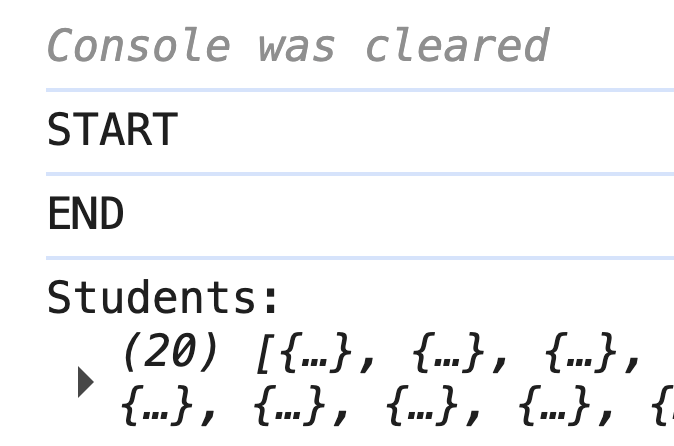

      - The arrow function passed to the filter method (highlighted above) is
      a callback function, because it is provided as an argument to the
      higher-order function filter.

      - That same function is also a **closure**. Why?
      Because it accesses the constant filterCourse, which is defined in its
      outer lexical scope (in this case, inside the fetchStudents function).
      This creates a closure, since the arrow function "captures" or closes
      over the filterCourse constant, retaining access to it even though the
      surrounding function (fetchStudents) has already finished execution.

      - The fact that the callback is also a closure allows it to access data
      from outside the function without passing it as an argument. This is
      important because the arguments of a callback are determined by the
      function that invokes it---the higher-order function (in this case,
      filter)---and not by the callback itself.

  2.  Next example illustrates how to create a closure to enforces
        encapsulation in functional programming.

      ```js
      const person1 = () => {
        let firstName = "John";
        let lastName = "Doe";

        return () => `${firstName} ${lastName}`;
      };

      console.clear();
      const getFullName = person1();
      console.log(typeof getFullName);
      console.log(getFullName);
      console.dir(getFullName);
      console.log(getFullName());
      ```

      - The output should look similar to the following:

      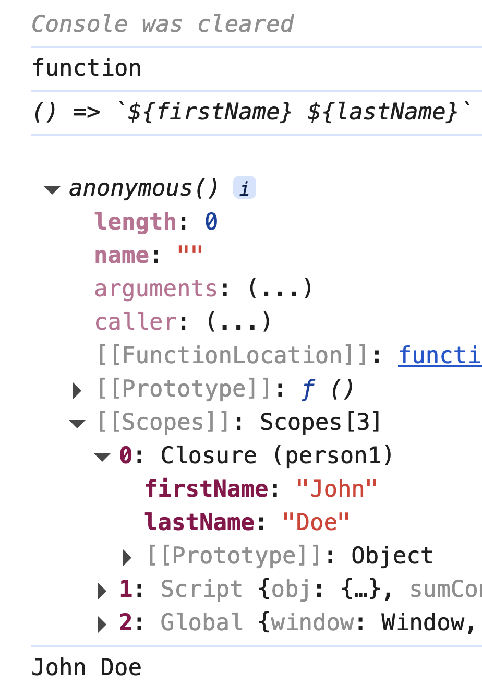

      - person1 is a function that returns an inner function. This inner
      function is a closure because it captures the values of the firstName
      and lastName variables. Even after person1 finishes executing, the
      closure still has access to these variables.

      - The constant getFullName holds a reference to the closure returned by
      person1. This makes it somewhat similar to a public method of an
      object: it is accessible outside of person1. In contrast, the
      variables firstName and lastName remain inaccessible from the outside,
      effectively acting as the private data of the function.

      - When analyzing the output of console.dir(closureFunction), we can
      inspect the closure's scope. Outside of this, the captured variables
      are not visible or accessible through any other structure. This
      inspection is mainly useful for debugging and understanding how
      closures work, not something typically used in production code.

  3.  The next example demonstrates how closures can be used to return an object in which only function properties (methods) are exposed. The object itself does not directly contain the data, but its methods have access to the data defined in the outer function (getPersonObject). This data behaves like private data for the returned object, enabling us to create an object with public methods and private state. This approach is commonly known as the **module pattern** in JavaScript.

      ```js
      const getPersonObject = () => {
        let firstName = "John";
        let lastName = "Doe";
        let dateOfBirth = new Date(1995, 8, 20);

        return {
          fullName: () => `${firstName} ${lastName}`,
          age: () => {
            const today = new Date();
            let age = today.getFullYear() - dateOfBirth.getFullYear();
            let deltaM = today.getMonth() - dateOfBirth.getMonth();
            if (
              deltaM < 0 ||
              (deltaM === 0 && today.getDate() < dateOfBirth.getDate())
            ) {
              age--;
            }
            return age;
          },
        };
      };

      console.clear();
      const person = getPersonObject();
      console.dir(person);
      console.log(person.fullName());
      console.log(person.age());
      ```

  - The output should look similar to the following:

      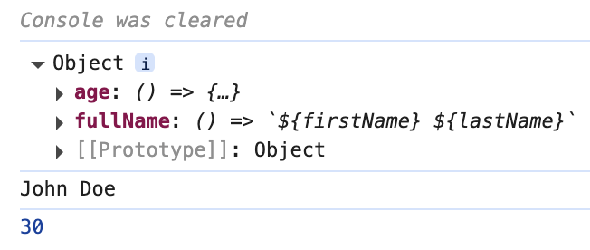

  - The object returned in the current exercise is somewhat similar to the object literal from exercise [24](#_Ref209193203). Both expose methods and can work with data, but the difference lies in how that data is managed. In exercise [24](#_Ref209193203), the data is part of the
      object itself, which means it is exposed and accessible through the
      `this` reference. In the current exercise, however, the object does not
      store the data directly; instead, it relies on variables defined in
      the outer function. This means the data remains private, hidden from
      the outside, and only accessible through the returned methods. Because
      of `this`, the closure-based approach enforces encapsulation, while the
      object literal does not. Additionally, since the data is accessed
      directly from the closure rather than through `this`, we can freely use
      arrow functions here without restriction.

  4.  The final version of the current exercise will also use getters and
        setters to abstract access to the data through methods: get methods
        to read data and set methods to write data. For more details about
        getters and setters, consult the MDN documentation for
        [get](https://developer.mozilla.org/docs/Web/JavaScript/Reference/Functions/get)
        and [set](https://developer.mozilla.org/docs/Web/JavaScript/Reference/Functions/set).

      ```js
      const getPersonObject2 = () => {
        let firstName = "John";
        let lastName = "Doe";
        let dateOfBirth = new Date(1995, 8, 20);

        return {
          get firstName() {
            return firstName;
          },
          set firstName(value) {
            firstName = value;
          },
          get lastName() {
            return lastName;
          },
          set lastName(value) {
            lastName = value;
          },
          get dateOfBirth() {
            return dateOfBirth;
          },
          set dateOfBirth(value) {
            dateOfBirth = value;
          },

          fullName: () => `${firstName} ${lastName}`,
          age: () => {
            const today = new Date();
            let age = today.getFullYear() - dateOfBirth.getFullYear();
            let deltaM = today.getMonth() - dateOfBirth.getMonth();
            if (
              deltaM < 0 ||
              (deltaM === 0 && today.getDate() < dateOfBirth.getDate())
            ) {
              age--;
            }
            return age;
          },
        };
      };

      console.clear();
      const person2 = getPersonObject2();
      console.dir(person2);
      console.log(person2.firstName);
      console.log((person2.firstName = "Jane"));
      console.log((person2.lastName = "Smith"));
      console.log(person2.fullName());
      console.log(person2.age());
      console.log((person2.dateOfBirth = new Date(1970, 5, 15)));
      console.log(person2.age());
      ```

  - The output should look similar to the following:

      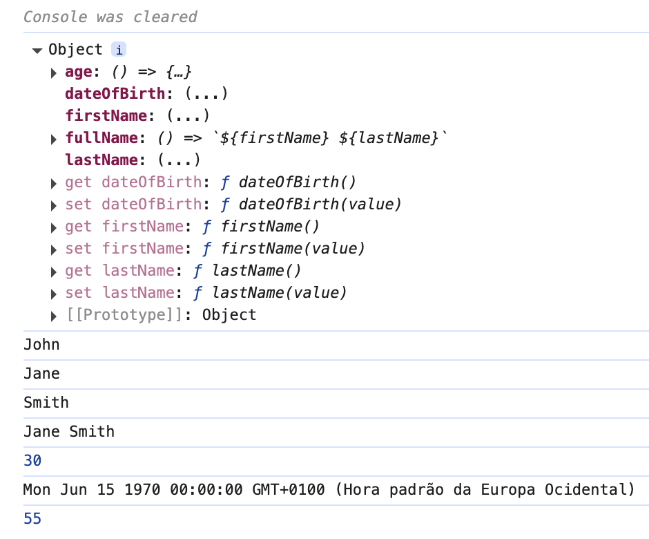

# Asynchronous programming

In this section, we will explore asynchronous programming in JavaScript
by working with Promises using both chaining syntax and the async/await
keywords.

For practice, we will use the function simulateHttpRequest(), which
mimics HTTP requests and responses, so we don't need to set up a real
API server. If we wanted to call a real API instead, we could use the
native Fetch API (available in modern browsers) or external libraries
such as Axios. Behavior of simulateHttpRequest()is conceptually very
similar to fetch(), axios.get(), or other HTTP client libraries: all of
them rely on Promises to handle asynchronous request/response operations
and share the same general usage pattern. Examples of code:

```js
const promise1 = simulateHttpRequest("url").then((response) => {
  // ... callback that process the response
});

const promise2 = fetch("url").then((response) => {
  // ... callback that process the response
});

const promise3 = axios.get("url").then((response) => {
  // ... callback that process the response
});
```

- All three alternatives --- simulateHttpRequest(), fetch(), and
  axios.get() --- return a Promise.

- They differ in their input arguments and the structure of their
  responses, but the syntax and behavior are the same, so controlling
  asynchronous programming works with the same pattern.

The function simulateHttpRequest() accepts the following arguments:

- url -- the URL of the simulated HTTP request. It can be any string (no
  real URL is used). However, some strings are predefined with special
  behavior --- check the file simulateHttpRequest.js for details.

- body -- an object representing the request body (simulated only).

- time (default = null) -- the time, in milliseconds, the request takes
  to complete. If null, a random time between 10 ms and 30 ms is chosen.

- success (default = true) -- whether the request resolves successfully
  or is rejected with an error.

- debug (default = true) -- whether to log two messages to the console:
  one when the request is sent (simulated) and one when the response is
  received (also simulated).

In this section, all code should be written in async.js and executed
through async.html.

42.  For our first example, we will simulate an HTTP request that returns an array of student objects and display them in an HTML table.
      1.  Begin by examining the following implementation, which is
        incorrect but represents a common pitfall.

      ```js
      console.clear();

      const students = simulateHttpRequest("students");
      console.log("Students: ", students);
      showArrayOnTable("data-table-1", students);
      ```

      - The output should look similar to the following:
        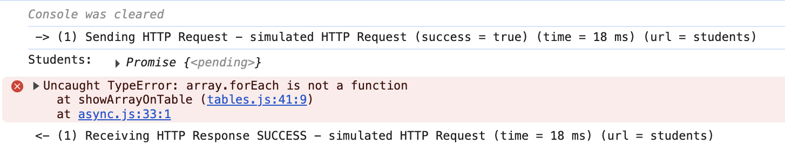

      - The function simulateHttpRequest does not directly return the HTTP response; instead, it returns a promise. As a result, the constant students do not contain the expected data but a promise object (as shown in the console output). By the time the promise is resolved or rejected, the surrounding code has already finished executing.

      2.  The correct approach requires handling the HTTP response only after the promise is resolved. The timing of this resolution is not under
    our direct control --- this is a fundamental principle of
    asynchronous programming. We initiate an action (in this case,
    sending an HTTP request). While the promise is pending, the main
    thread continues executing other code. The response is only handled
    once the promise settles, either successfully or with an error.
      - Test and analyze the solution for our problem (simulate an HTTP
      request that returns an array of student objects and display them
      in an HTML table) using **chaining syntax**:

        ```js
        console.clear();
        console.log("START");

        simulateHttpRequest("students")
          .then((response) => {
            const students = response.data;
            console.log("Students: ", students);
            showArrayOnTable("data-table-1", students);
          })
          .catch((error) => {
            console.log("Caught an error: " + error.message);
          });

        console.log("AFTER simulateHttpRequest call");
        ```

      - Expected console output:

        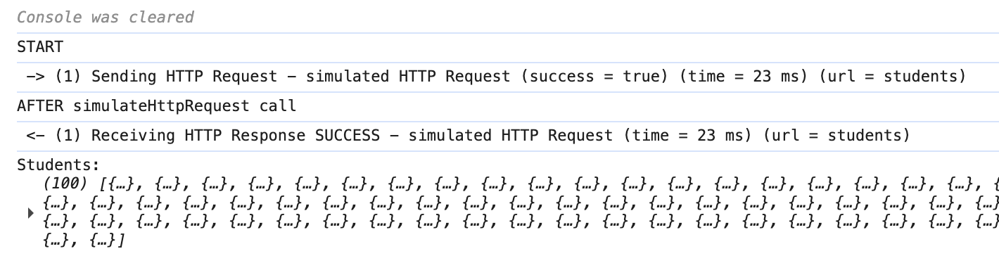

      - The page will display a table with the array of student objects
  returned by the simulated API.

        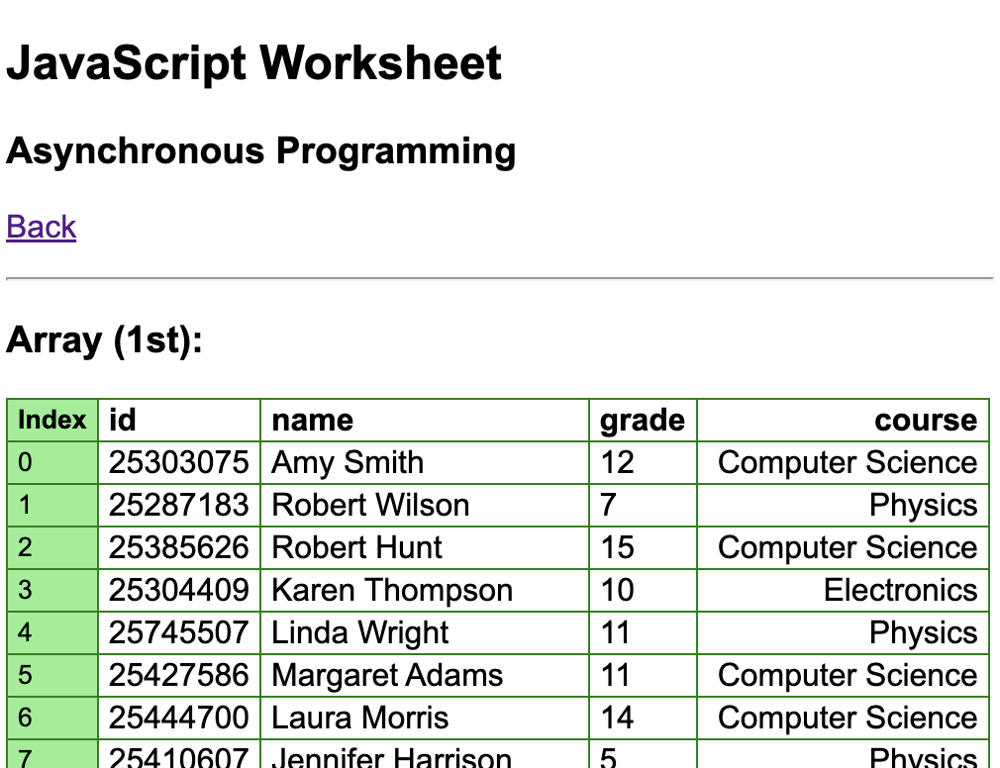

      - Sequence of execution is the following (demonstrated by the output
  console):
        - The console writes "START" and then calls simulateHttpRequest,
          which initiates the process to send the simulated HTTP request.

        - The function simulateHttpRequest returns a promise right away,
          allowing the asynchronous operation to continue in the background

        - Execution continues on the main thread, which writes "AFTER
          simulateHttpRequest call" to the console output.

        - Once the simulated server finishes processing, the application
          receives the HTTP response. In real-world usage, the timing depends
          on the API server and network performance.

        - When the HTTP response is received, the promise returned by
          simulateHttpRequest is resolved if successful (fulfilled) or
          rejected if an error occurs.

        - If the promise is resolved, it invokes the associated .then
          callback; if it is rejected, it invokes the .catch callback.

        - In this example, the request is successful, so the .then callback is
          invoked, receiving the response object (containing the server's
          returned data) as its argument.

        - Inside the .then callback, we handle the response data --- in this
          case, we log the array of student objects to the console and pass it
          to the showArrayOnTable function.

      3.  The previous solution uses the chaining syntax, which is one way to
    handle asynchronous programming. ECMAScript 2017 (ES8) introduced
    the **async/await** keywords as an alternative approach. Under the
    hood, both methods use Promises to manage asynchronous operations.
    The following code demonstrates a solution using async/await for
    the same problem:

          ```js
          const fetchStudents = async () => {
            try {
              const request = await simulateHttpRequest("students");
              const student = request.data;
              console.log("Students: ", student);
              showArrayOnTable("data-table-1", student);
              return student;
            } catch (error) {
              console.log("Caught an error: " + error.message);
            }
          };

          console.clear();
          console.log("START");

          const resultOfAsyncFunction = fetchStudents();
          console.log("Result of fetchStudents async function: ", resultOfAsyncFunction);
          console.log("AFTER fetchStudents call");
          ```

      - Expected console output:

        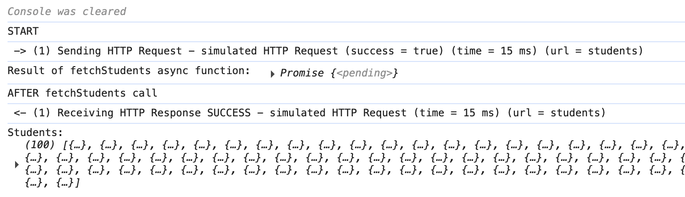

      - Some considerations about the code:
        - The await keyword prefixes a statement that returns a Promise.
    Conceptually, it tells the async function to "wait in the waiting
    room" until the Promise is resolved or rejected before continuing to
    the next line.

        - Using await, the code inside the async function reads like "normal"
    synchronous code --- top-down, line by line --- because each awaited
    operation temporarily pauses execution inside the function.

        - The await keyword only works inside an async function. Think of the
    async function as a "waiting room" where operations pause
    temporarily, but outside the function, the main thread continues
    running as usual.

        - Because fetchStudents is an async function, calling it without await
          immediately returns a Promise. This Promise is only settled
          (resolved or rejected) once the function completes, including all
          awaited statements. That is why resultOfAsyncFunction is a Promise,
          not the actual array of students.

        - When an async function is called with await (from inside another
          async function), execution pauses until the function completes, and
          it returns the value specified by its return statement.

        - In this example, we cannot use await with fetchStudents() at the top
          level because the surrounding code is not inside an async function.

        - To access the resolved student array directly, you need to call
          fetchStudents() from within another async function using await.
          Compare the following code with the previous version and analyze the
          difference:

          ```js
          console.clear();
          console.log("Before call 2");

          void (async () => {
            const students = await fetchStudents();
            console.log("Students from second fetchStudents: ", students);
          })();

          console.log("After call 2");
          ```

      - Expected console output:

        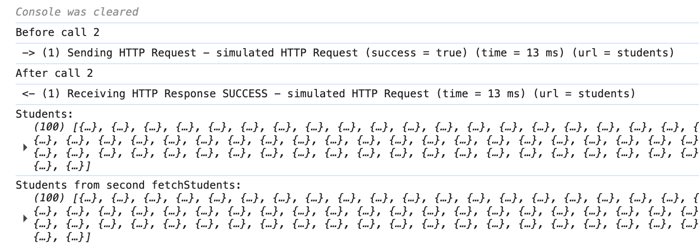

43. <a id="_Ref210062843"></a>Sometimes we need to call API endpoints in a specific order. For example, endpoint B must be called only after
    endpoint A, because the HTTP request to B depends on the output
    of A. In this exercise, we will first call the "price" endpoint,
    which returns the price of a product (in this simulation, it simply
    returns a random value). Then, we will call the "addtaxes"
    endpoint, which calculates the taxes based on the price returned by
    "price".
    1.  Start by examining the following implementation that represents
        a common mistake. It uses chaining syntax but is not a correct
        solution for the exercise -- however, it is representative of
        errors that beginners often make.

        ```js
        console.clear();
        console.log("START");

        let price = null;
        let finalPrice = null;

        simulateHttpRequest("price", null, 200) // it takes 200ms to return the price
          .then((response) => {
            price = response.data;
            console.log("Price: " + price);
          })
          .catch((error) => {
            console.log("Caught an error: " + error.message);
          });

        simulateHttpRequest("addtaxes", price)
          .then((response) => {
            finalPrice = response.data;
            console.log("Final Price (after taxes): " + finalPrice);
          })
          .catch((error) => {
            console.log("Caught an error: " + error.message);
          });

        console.log("END");
        ```

      - Analyze the code and the output console. Expected console output is
      similar to:

        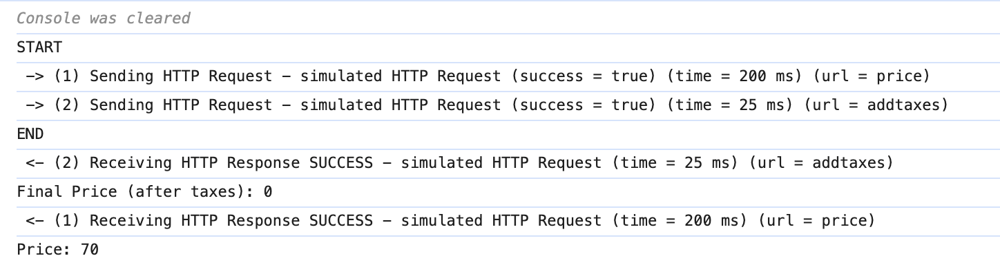

      - The function simulateHttpRequest is called twice, and in both cases,
      it returns a Promise. Meanwhile, the main thread continues executing
      until the console.log('END') statement. When the second
      simulateHttpRequest is invoked (for the "addtaxes" endpoint), the
      value of price is still null---the first simulateHttpRequest has not
      yet been resolved or rejected.

      - In this example, we intentionally made the first call (price) slower
      than the second (addtaxes). This demonstrates that we cannot control
      the order in which the responses are received.

    2.  Our second implementation will work as expected, but it is not yet
        an ideal solution for calling endpoints in a specific order. While
        it produces the correct results, the code quickly becomes hard to
        read and maintain when we nest multiple callbacks. This situation is
        commonly known as a **callback nightmare**, and it demonstrates why
        we need better ways---like Promise chaining or async/await---to
        handle sequential asynchronous operations.

        ```js
        console.clear();
        console.log("START");

        simulateHttpRequest("price", null, 200) // it takes 200ms to return the price
          .then((response) => {
            let price = response.data;
            console.log("Price: " + price);

            simulateHttpRequest("addtaxes", price)
              .then((response) => {
                let finalPrice = response.data;
                console.log("Final Price (after taxes): " + finalPrice);
              })
              .catch((error) => {
                console.log("Caught an error on addtaxes: " + error.message);
              });
          })
          .catch((error) => {
            console.log("Caught an error on price: " + error.message);
          });

        console.log("END");
        ```

    - Analyze the code and the output console. Expected console output is
      similar to:

      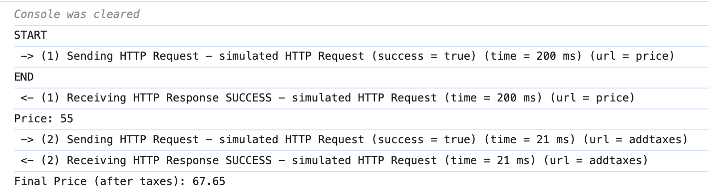

    - This solution works because the second endpoint (addtaxes) only starts
      after the first endpoint (price) is resolved. That is the correct
      principle when calling multiple endpoints in a specific order.
      However, since we are calling the second endpoint inside the callback
      of the first, we end up nesting callbacks. This is fine for a small
      number of operations, but if we had, for example, 10 sequential
      operations, we would have 9 levels of nested callbacks. This
      situation---deeply nested callbacks that are hard to read and
      maintain---is commonly referred to as a callback nightmare.

    3.  Our third solution will also use the chaining syntax, but this time
        we apply Promise chaining correctly. When we want to chain two
        asynchronous operations (that return Promises) so that operation B
        runs after operation A, we simply ensure that the .then callback of
        the first operation returns the Promise of the second operation. If
        we need to call 10 sequential operations, we can write 10 .then
        callbacks at the same level---there is no nesting of operations.
        Additionally, a single .catch callback is sufficient to handle
        errors from any of the chained operations.

        ```js
        console.clear();
        console.log("START");

        simulateHttpRequest("price", null, 200) // it takes 200ms to return the price
          .then((response) => {
            let price = response.data;
            console.log("Price: " + price);
            return simulateHttpRequest("addtaxes", price);
          })
          .then((response) => {
            let finalPrice = response.data;
            console.log("Final Price (after taxes): " + finalPrice);
          })
          .catch((error) => {
            console.log("Caught an error: " + error.message);
          });

        console.log("END");
        ```

    - Analyze the code and the output console. Expected console output is
      similar to:

      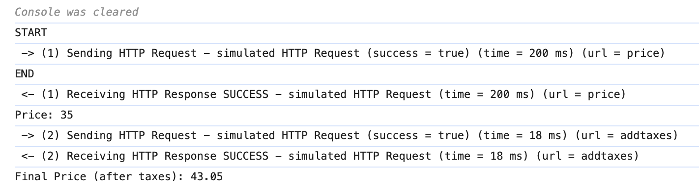

    4.  Our fourth and simplest solution will use multiple await statements.
        Because await pauses execution until the Promise is resolved or
        rejected, it naturally ensures that all operations are executed
        sequentially.

        ```js
        const fetchPrice = async () => {
          try {
            const response = await simulateHttpRequest("price");
            const price = response.data;
            console.log("Price: ", price);

            const finalPrice = (await simulateHttpRequest("addtaxes", price)).data;
            console.log("Final Price (after taxes): ", finalPrice);

            return finalPrice;
          } catch (error) {
            console.log("Caught an error: " + error.message);
          }
        };

        console.clear();
        console.log("START");

        fetchPrice()
          .then((finalPrice) => {
            console.log(
              "Final Price returned by fetchPrice async function: ",
              finalPrice,
            );
          })
          .catch((error) => {
            console.log("Caught an error: " + error.message);
          });

        console.log("END");
        ```

    - Analyze the code and the output console. Expected console output is
      similar to:

      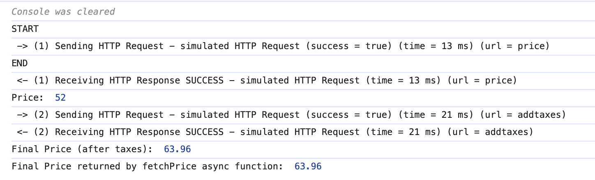

    - Some considerations about the code:
      - The line that calls the second endpoint (addtaxes) does not store
        the result in an intermediate variable or constant. Instead, it is
        used directly as an expression to obtain the returned value from the
        endpoint immediately. This avoids creating unnecessary intermediate
        references.

      - When calling the function fetchPrice, which is an async function, we
        used the chained .then() syntax, because fetchPrice returns a
        Promise. This is why we can apply Promise chaining to handle its
        result. Why did we do this?
        - In this context, we cannot use await directly when calling
          fetchPrice, because it is invoked outside of an async function.

        - If we did not need the result of fetchPrice, we could simply call
          it without await or chaining, like this: fetchPrice()

        - However, since we want to use the returned result of fetchPrice
          (to log it in the console), we have two options:
          1.  Wrap the call to fetchPrice inside a new async function and
              use await.

          2.  Use Promise chaining - .then() and .catch() - directly on the
              fetchPrice call, as we did here.

      - **Additional comment**: This example highlights how async/await and
        Promise chaining can be combined. Even though fetchPrice internally
        uses await for sequential operations, its return value is still a
        Promise. Therefore, outside an async context, we handle it with
        .then() and .catch(). This is a common pattern in real-world
        JavaScript code.

      - The line that calls the second endpoint (addtaxes) does not return
        the endpoint result to an extra variable or constant. Instead, it is
        uses as an expression so that we can obtain the value returned by
        the endpoint directly (without any intermediate reference)

      - When calling the function fetchPrice, which is an async function,
        we've used the chained syntax, because the fetchPrice is an async
        function that returns a promise - that is why we can apply the
        chained promises syntax. Why have we done this?
        - In this context, we could not call the fetchPrice function with
          the await keyword, because the function is called outside an
          "async" context

        - If we do not needed the result of the fetchPrice, we could just
          call it without await or any other modification -- code would be:
          fetchPrice()

        - However, since we needed the result of the fetchPrice async
          function (to show it in a console output message), we two options
          -- to incorporate the fetchPrice call inside a new async function
          or use the chained syntax on the async function (with .then and
          .catch callbacks).

44.  **Optional Exercise** -- The function
    simulateHttpRequest includes the endpoint "step" that returns the
    next step given a previous step. For this example, the step is
    represented as an integer. The "step" endpoint accepts the
    previous step (an integer) in the request body (the 2nd argument
    of simulateHttpRequest) and returns the new step (previous step +
    1). If no step is provided in the body, it returns 1.
    
      The objective of this exercise is to call the "step" endpoint five
    times in the correct order, so that the calls return the numbers 1,
    2, 3, 4, 5 in exactly this sequence. Note that the duration for the
    five calls should be: 300ms for the first call, then 20ms, 100ms,
    5ms, and finally 200ms.
    
      Implement and compare three alternative solutions, following the
    same patterns used in exercises 43.2, 43.3, and 43.4. The output
    console should be similar to the following:

      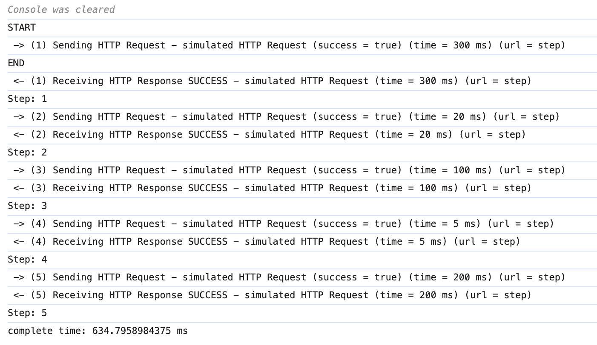

45.  <a id="_Ref210062880"></a>Our next exercise addresses the opposite
    challenge compared to previous exercises. Instead of enforcing a
    controlled sequence of operations, the goal here is to maximize
    performance by executing a set of unrelated operations
    simultaneously, where the order does not matter and none of the
    operations depend on the others.
    
      This pattern is particularly useful when loading a set of unrelated
    data from an API, such as lists of courses, countries, or
    categories.

      - Specifically, we will invoke three endpoints:
        - "something?a=1&b=2" -- 190ms

        - "students?size=50" -- 200ms

        - "anotherthing" -- 130ms

      All solutions for this exercise will use async/await syntax.
      1.  First, we will implement the exercise by executing three await
      statements one after another, without any adjustments. This
      implementation produces the expected results, but the three
      endpoints are not executed simultaneously. As a result, the total
      duration of the three calls will be the sum of the individual
      durations.

          This is known as the **Sequential Await Pitfall**, where each
          asynchronous operation waits for the previous one to complete
          before starting, often causing unnecessary delays.

          ```js
          console.clear();
          console.time("complete time");
          console.log("START");

          void (async () => {
            try {
              let response = await simulateHttpRequest("something?a=1&b=2", null, 190);
              console.log("something?a=1&b=2", response.data);
              console.timeLog("complete time");

              response = await simulateHttpRequest("students?size=50", null, 200);
              console.log("students?size=50", response.data);

              console.timeLog("complete time");

              response = await simulateHttpRequest("anotherthing", null, 130);
              console.log("anotherthing", response.data);

              console.timeEnd("complete time");
            } catch (error) {
              console.log("Caught an error on step: " + error.message);
            }
          })();

          console.log("END");
          ```

      - Analyze the code and the output console. Expected console output is
      similar to:

        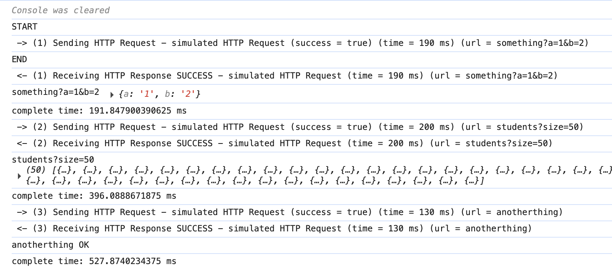
      - The total duration is always a little above 520ms (190ms + 200ms +
        130ms)

      2. For our first solution that ensures all three operations run
        simultaneously, we start them without using the await keyword. Only
        after all operations have been initiated do we begin awaiting their
        results.

          ```js
          console.clear();
          console.time("complete time");
          console.log("START");

          void (async () => {
            try {
              let firstPromise = simulateHttpRequest("something?a=1&b=2", null, 190);
              let secondPromise = simulateHttpRequest("students?size=50", null, 200);
              let thirdPromise = simulateHttpRequest("anotherthing", null, 130);

              console.timeLog("complete time");

              let firstResult = await firstPromise;
              let secondResult = await secondPromise;
              let thirdResult = await thirdPromise;

              console.log("something?a=1&b=2", firstResult.data);
              console.log("students?size=50", secondResult.data);
              console.log("anotherthing", thirdResult.data);

              console.timeEnd("complete time");
            } catch (error) {
              console.log("Caught an error on step: " + error.message);
            }
          })();

          console.log("END");
          ```

      - Analyze the code and the output console. Expected console output is
      similar to:

        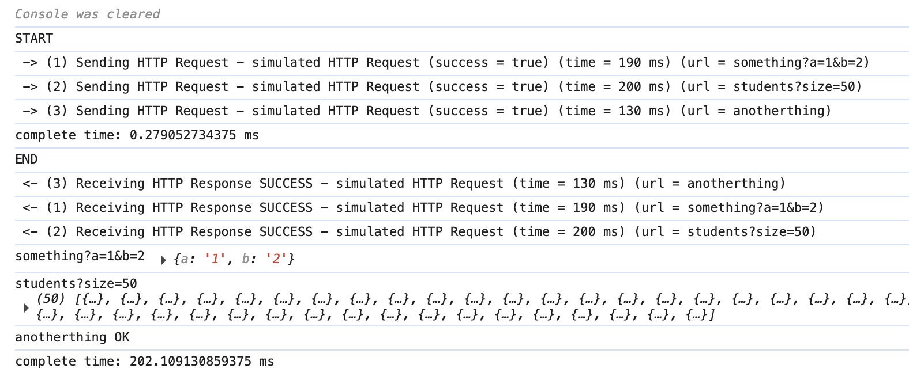

      - Note that the results are the same, but the total duration for all
      three operations is now just over 200ms---the time of the longest
      operation. This is because all operations run simultaneously.

      3.  The final solution to address the Sequential Await Pitfall will
        produce similar results and performance compared to the previous
        solution. This time, however, we use the **Promise.all()** method,
        which allows us to execute multiple promises in parallel and returns
        a single promise that resolves when all of them are completed (or
        rejects immediately if any of them fail).

          ```js
          console.clear();
          console.time("complete time");
          console.log("START");

          void (async () => {
            try {
              const [firstResult, secondResult, thirdResult] = await Promise.all([
                simulateHttpRequest("something?a=1&b=2", null, 190),
                simulateHttpRequest("students?size=50", null, 200),
                simulateHttpRequest("anotherthing", null, 130),
              ]);

              console.log("something?a=1&b=2", firstResult.data);
              console.log("students?size=50", secondResult.data);
              console.log("anotherthing", thirdResult.data);

              console.timeEnd("complete time");
            } catch (error) {
              console.log("Caught an error on step: " + error.message);
            }
          })();

          console.log("END");
          ```

      - Analyze the code and the output console. Expected console output is
      similar to:

        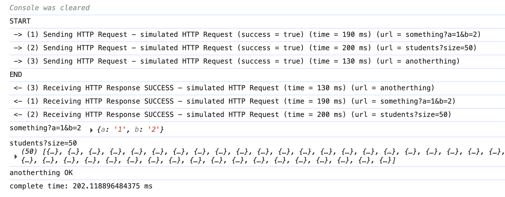

      - The results and the performance are similar to previous exercise.

46.  Our final exercise on asynchronous programming combines two
    requirements:
      - A set of operations that must run sequentially in a predefined
      order.

      - A set of operations that can run in parallel to optimize
      performance.

      The specific objective is to call the "price" endpoint (200 ms)
      followed by "addtaxes" (50ms) - in the same order as in exercise
      [43](#_Ref210062843) -, while at the same time running the three
      endpoints from exercise [45](#_Ref210062880):
      - "something?a=1&b=2" -- 190 ms

      - "students?size=50" -- 200 ms

      - "anotherthing" -- 130 ms

  - **Recommendation**: whenever you face a mix of
      sequential and parallel operations, encapsulate each sequential
      set of tasks inside its own async function. Since async functions
      return promises, they can then be combined with the independent
      operations using **Promise.all()**. This ensures that dependent
      tasks preserve their required order, while unrelated tasks run
      concurrently for maximum efficiency.

  - Expected console output is similar to:

      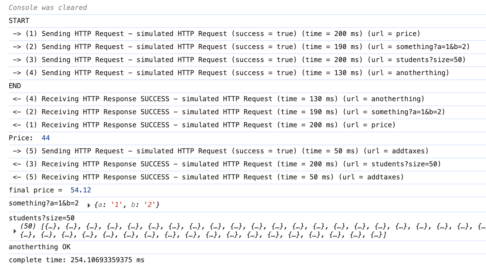

  - Note that the total duration of all operations is slightly longer
      than the duration of the longest operation (250ms), treating the
      "price" + "addtaxes" sequence as a single operation since they
      must run one after the other. "Price" takes 200ms and
      "addtaxes" takes 50ms, so their combined duration is just over
      250ms. All other operations complete in less than 250 ms.

# Modules

In this section, we'll work with JavaScript modules. You'll learn how to
use export to share code between files and import to use it elsewhere,
following the standard ES6 module format.

47.  First, create the folder "modules" inside the folder "js".
    We'll add our modules to this new folder.

48. On the "js/modules" add the following files (empty files for now):
    - tables.js

    - students.js

    - simulatedHttpRequest.js

49. On the "js" add the file asyncWithModules.js -- this will be the
    main file, executed by the browser. This file will use the modules
    we will create.

50. In the file modules.html, add a reference to asyncWithModules.js.
    Since we are using ES6 modules, the ```<script>``` tag must specify
    type="module"---this is required for the browser to recognize and
    load ES6 modules correctly:

    ```html
    <script type="module" src="js/asyncWithModules.js"></script>
    ```

51. We'll start by creating the modules/tables.js module, based on the
    existing file js/tables.js. Copy the code from js/tables.js into
    modules/tables.js.

52. Next, export the two functions from this file:

53. We'll start by creating the modules/tables.js module, based on the
    file js/tables.js. Copy the code of the file js/tables.js to the
    file modules/tables.js. Next, export the two functions of this file:

      ```js
      export const showArrayOnTable = (tableId, array) => {
        . . .
      }

      export const showObjectOnTable = (tableId, obj) => {
        . . .
      }
      ```

    - That's it for the modules/tables.js module. By exporting these
  functions, we can reuse them in any other module or file using import,
  keeping our code organized and avoiding duplication.

54. The next module to create is modules/students.js, based on the
    existing file js/students.js. Copy the code from js/students.js into
    modules/students.js. Then, export the following functions:

    ```js
    export const createRandomStudentObject = () => {
      . . .
    }

    export const createRandomStudentWithCourseObject = () => {
      . . .
    }

    export const createArrayOfStudents = (size, includeCourse = false) => {
      . . .
    }
    ```

55. The last module to create is modules/simulateHttpRequest.js. Copy
    the code from js/simulateHttpRequest.js into
    modules/simulateHttpRequest.js.
    - This module uses the function showArrayOnTable from the "tables"
      module, so it needs to import that function.

    - Also, instead of exporting simulateHttpRequest by name, the module
      will export it as the default export.

      ```js
      import { createArrayOfStudents } from './students.js'

      . . .

      export default (url, body, time = null, success = true, debug = true) => {
        . . .
      }
      ```

56. Finally, in the file asyncWithModules.js, we will implement the code
    to load the students from the simulated API and display them in the
    HTML table. To achieve this, we'll use the functions exported by the
    different modules as needed. The complete code for
    asyncWithModules.js is shown below:

    ```js
    import simulatedFetch from "./modules/simulateHttpRequest.js";
    import { showArrayOnTable } from "./modules/tables.js";

    // Clear HTML tables
    showArrayOnTable("data-table-1", []);
    showArrayOnTable("data-table-2", []);

    const fetchStudents = async () => {
      try {
        const request = await simulatedFetch("students");
        const student = request.data;
        console.log("Students: ", student);
        showArrayOnTable("data-table-1", student);
        return student;
      } catch (error) {
        console.log("Caught an error: " + error.message);
      }
    };

    console.clear();
    fetchStudents();
    ```

  - Note that when importing a default export (such as a function, class,
  or object), we must assign it a name at the point of import. In this
  case, the default function exported by the simulateHttpRequest module
  is imported with the name simulatedFetch.

  - Named exports, like the showArrayOnTable function, can also be renamed
  at import time using the following syntax:

    ```js
    import { showArrayOnTable as newName } from "./modules/tables.js";
    ```

  - It is also possible to import all elements of a module using the
  following syntax:

    ```js
    import * as tables from "./modules/tables.js";

    // We can use all exported elements of the module using the following code
    tables.showArrayOnTable("data-table-1", []);
    tables.showObjectOnTable("data-table-2", {});
    ```

# DOM

This section is **OPTIONAL**

In this section, we'll take a look at the Document Object Model (DOM)
API, which allows JavaScript to manipulate page content and is a
fundamental building block for creating client-side applications.

This section is optional because, in practice, we will use a UI
framework (such as Vue.js, React, or Angular) to handle rendering in the
browser. These frameworks rely on the DOM API internally, but they
abstract away most of the direct interactions, so developers rarely need
to work with the DOM API directly. For that reason, we won't explore it
in depth here, but knowing the DOM API is useful for understanding what
frameworks do under the hood

The DOM API is extensive --- modern browsers expose hundreds of objects
and thousands of methods and properties that enable JavaScript to
interact with web pages. In the following section, we'll present a
concise overview of some of the most useful functions, organized into
three categories and illustrated with code examples:

- Selection functions -- used to select one or more elements from the
  page

  ```js
  // Select a single element by ID
  const header = document.getElementById("header");

  // Select the first element that matches a CSS selector
  const firstItem = document.querySelector(".item");

  // Select all elements that match a CSS selector
  // Returns a NodeList which can be iterated over
  const allItems = document.querySelectorAll(".item span");
  ```

- Elements manipulation -- modify the structure or content of the page

  ```js
  const link = document.getElementById("myLink");

  // Change content
  link.textContent = "Visit Example";

  // Change an attribute
  link.href = "https://example.com";

  // Add and remove a class
  link.classList.add("highlight");
  link.classList.remove("hidden");
  ```

- Events -- handle user actions or browser-triggered interactions

  ```js
  // Page load event
  window.addEventListener("load", () => {
    console.log("Page fully loaded");
  });

  const button = document.getElementById("myButton");

  // Respond to a click
  button.addEventListener("click", () => {
    console.log("Button clicked!");
  });

  // Respond to mouse over
  button.addEventListener("mouseover", () => {
    button.style.backgroundColor = "lightblue";
  });
  ```

57. In this first DOM exercise, review and study the showArrayOnTable
    and showObjectOnTable functions (from the tables.js file). These
    functions generate dynamic HTML tables from an array or an object,
    and understanding them will help you grasp key DOM features.

58. Create a new JavaScript file in the js folder with the name dom.js.
    Add a reference to that file in the dom.html file using the module
    type:

    ```html
    <script type="module" src="js/dom.js"></script>
    ```

59. The structure of the new file (dom.js) will be the following:

    ```js
    import { createArrayOfStudents } from "./modules/students.js";
    import * as tables from "./modules/tables.js";

    tables.showArrayOnTable("data-table-1", createArrayOfStudents(100));
    tables.showArrayOnTable("data-table-2", []);

    // Add other functions or any type of elements, as needed
    const changeTableOnPage = (id) => {
      // Code that changes the table on the HTML page
    };

    changeTableOnPage("data-table-1");
    ```

60. Add the necessary code to the function changeTableOnPage(id), and,
    if needed, include other JavaScript elements (variables, constants,
    objects, functions, etc.) in the dom.js file so that executing
    `changeTableOnPage('data-table-1')` updates the table on the page
    according to the following requirements:

    - Do not access the original array used to generate the HTML table ---
  all code must manipulate the table using only the DOM API. Assume the
  student array is unknown to the programmer.

    - Do not modify tables.js --- the showArrayOnTable function cannot be
  changed in any way.

    - The table's behavior should be updated as follows:
      - When the user clicks on a grade value, all rows corresponding to
    students with that same grade should be highlighted in light blue.
    The index column should remain green.

      - When the user clicks elsewhere in the table (outside the grade
    value), all rows should revert to a white background, except for the
    index column, which remains green.

    - Tip: Use event delegation by attaching a single click listener to the
  table. Inside the listener, the callback argument event lets you
  identify which element was clicked. The property event.target provides
  a reference to that element. For <td> elements, you can use the
  cellIndex property to get the index of the cell within its row, and
  the method closest('tr') to retrieve a reference to the
  corresponding row.

    - The table should appear as shown below when the user clicks on a grade
  cell with the value "8": all rows where the grade is 8 are
  highlighted in light blue, while the index column remains green.

    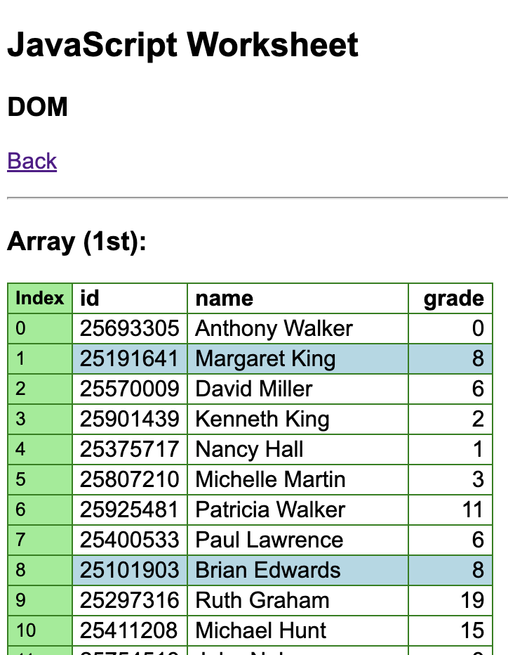

# TypeScript

This section is **OPTIONAL**

In this section, we’ll take a look at TypeScript, which adds strong typing to JavaScript during development and transpiles to standard JavaScript for execution. This section is optional, as plain JavaScript is the primary language for worksheets and the project. However, TypeScript is offered as an alternative for students who are prepared to undertake the additional independent research and self-guided learning it requires.

61.	Install TypeScript globally by executing the following command:

```
npm install -g typescript
```
  1. Test if tsc (TypeScript Compiler) is available by executing the following commands:
  ```
  tsc --version
  tsc --help
  ````
  
62. Create a new folder named  (either within the current project or as a standalone folder) and copy the previous completed solution (JavaScript-based) from the worksheet to this new folder. Check the folders structure:
Create a new folder named `TypeScript` (either within the current project or as a standalone folder) and copy the `src` folder content from current JavaScript solution into it. The new folder should contain the exact same content as the original src folder.

    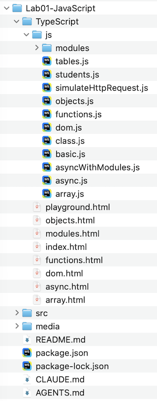

63. Initialize the folder `TypeScript` as a TypeScript project – it will add the TypeScript configuration file `tsconfig.json`. Execute the following command **inside the `TypeScript`** folder:
    ```
    tsc --init
    ```
  
64. Analyze the `tsconfig.json` file. Set the compilerOptions `rootDir` and `outDir` to:
  ```json
  {
    "compilerOptions": {
      "rootDir": "./src",
      "outDir": "./dist",
      // . . . 
  }
  ```

65. Also, change the environment settings module and target to **esnext**. This will ensure that the code will use the modern browser standard for modules and compilation output uses the latest JavaScript version.
  ```json
  {
    // . . . 
    "module": "esnext",
    "target": "esnext",
    // . . . 
  }
  ```

66.	Rename the `js` folder within `TypeScript` to `src` and all JavaScript files (extension `.js`) to became TypeScript files (extension `.ts`)

67.	Using a code editor like "Visual Studio Code" or similar, replace all JavaScript references on HTML files to use the compiled version (on dist folder) - replace all text occurrences of `js/` with `dist/` on all .html files. Also, ensure that all JavaScript references are of type "module" (type="module"). 
There are 15 occurrences to refactor. Example of one of the JavaScript references after refactoring:
  ```js
  <script type="module" src="dist/basic.js"></script>
  ```

68.	Compile all TypeScript files executing the following command on the folder `TypeScript`:  
  ```
  tsc
  ```
  - Compiling the code for the first time will result in numerous compilation errors:   

  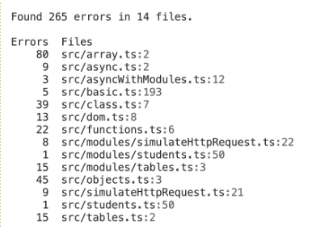

  - Many of these errors arise because the TypeScript configuration enforces strict typing rules. Rather than disabling these settings, we will refactor the worksheet's code to properly adhere to TypeScript standards

69.	To automatically recompile your TypeScript files whenever changes are saved, execute the following command:
  ```
  tsc --watch
  ```
70.	Compilation errors do not always prevent execution. For example, ensure that only exercise 1 in the basic.ts file is uncommented, while all other exercises remain commented out. Then, compile TypeScript files (command tsc) and open playground.html using a local web server, like the VS Code Live Server extension.
    ```js
    // Exercise 1: Hello World
    const contentElement = document.getElementById('content')
    contentElement.textContent = 'Hello World'
    console.log('Hello World')
    ````
  -	Even though basic.ts generates 1 compilation error, it will still run seamlessly in the browser.

    

71. Let's ensure that exercise 1 adhere to TypeScript standards, by specifying the type of the constant contentElement. Correct TypeScript code for exercise 1: 
    ```ts
    // Exercise 1: Hello World
    const contentElement = document.getElementById('content') as HTMLElement
    contentElement.textContent = 'Hello World'
    console.log('Hello World')
    ```
72. Refactor all exercises/files so that the code adheres to TypeScript standards – when completed, compilation should have no errors and the code should do exactly the same as before. Take into consideration the following:
    - Create the `Student` interface on `modules/students.ts` file using the code below and apply it when handling Student objects (such as in the functions createRandomStudentObject or createArrayOfStudents).

    ```ts
    export interface Student {
        id: number,
        name: string,
        grade: number,
        course: string | null
    }
    ````
    -  Create the `Person` `interface` on `objects.ts` file and ensure that person objects follow that interface.
    ```ts
      interface Person {
          firstName: string,
          lastName: string,
          dateOfBirth: Date,
          fullName: () => string,
          age: () => number
      }
    ````

    - In TypeScript, types and interfaces are static; you cannot mutate them by adding, replacing, or removing members after they are declared. Instead, you must derive new types by extending or combining existing ones.

    - For Exercise 28, instead of trying to add new properties to an existing object shape, create two new types that combine the `Person` interface with the additional properties using an intersection (&):

    ```ts
      type PersonWithContact = Person & {
          email: string,
          phone: string
      }

      type PersonWithChildren = Person & {
          children: string[]
      }    
    ```
    Here is an example of how to instantiate objects using these new intersection types. We use the object spread syntax (...) to copy properties from an existing base object (personB), ensuring the new objects satisfy all type requirements:
    ```ts
    const newPersonB1: PersonWithContact  = {
        ...personB,
        email: `${personB.firstName.toLowerCase()}.${personB.lastName.toLowerCase()}@example.com`,
        phone: '923 843 343',
    }

    const newPersonB2: PersonWithContact & PersonWithChildren  = {
        ...newPersonB1,
        children: [`Richard ${personB.lastName}`,  `Mary ${personB.lastName}`, ]
    }
    ```

  - Do not implement exercises 29, 30, 31, and 32, as they depend heavily on dynamically extending objects by adding new properties at runtime—a practice that contradicts TypeScript's strict static typing.

73. After completing all TypeScript conversion exercises, compare you solution to the one provided on the worksheet resolution.
