#

# Desenvolvimento de Aplicações Distribuídas

# Lab 03 - Memory Game

## Objective

This worksheet will help us learn about most the Vue.js features.

## Prerequisites

Building upon the concepts covered in Worksheet 2 (Lab02-DevEnv), where we explored the basics of Vue.js within a single page (component):

Ensure that all three projects (frontend, api, websockets) provided in the previous worksheet are running and that you can access the application in your browser. If that is not the case, please follow the instructions in [Initial Setup](initial_setup.md) to set up your development environment and install the dependencies for all projects.

## Structure

Before we begin, let’s consider how our Frontend (Vue.js) project will be organized. There are several ways to structure a project like this, but the most important characteristic is **consistency**. Maintaining a consistent structure allows all team members to easily understand where everything is located.
This will be the structure of our Vue.js application: 
````
<project>/                  ← Monorepo root
...
├── frontend/               ← Vue.js Frontend 
│   ├── public/*            ← Public files (index.html, favicon.ico, etc.)
│   ├── src/
│   	├── components/*    ← Components
│   	├── lib/*           ← Utilities and helper functions
│   	├── composables/*   ← Composables
│   	├── pages/*         ← Pages
│   	├── router/*        ← Routes - Vue Router
│   	├── stores/*        ← Global State - Pinia
│   	├── App.vue         ← Root Vue component
│   	├── main.js         ← JavaScript Entry point
│   ├── index.html          ← HTML Entry point
...
````

## Shadcn-vue Components

The Frontend project (Vue.js) will use the Shadcn-vue component library, built on top of Tailwind CSS. This library provides a set of accessible, pre-designed components that can be easily integrated into our application, allowing us to focus on building features rather than designing the UI from scratch.

1. For our project, we will use the following Shadcn-vue components. Run the following commands from the frontend project root to install them:
    ````bash
    # on the frontend root folder
    npx shadcn-vue@latest add card
    npx shadcn-vue@latest add navigation-menu
    npx shadcn-vue@latest add badge
    npx shadcn-vue@latest add sonner
    ````

    For the complete list of available components, check out the [Shadcn-vue Components](https://www.shadcn-vue.com/docs/components) list or explore the official [Shadcn-vue documentation](https://ui.shadcn.com/docs).
    
# Component basics

2. Create the following files:
    ```
    pages/game/SinglePlayerGamePage.vue
    pages/home/HomePage.vue
    components/game/GameBoard.vue
    components/game/MemoryCard.vue
    ```

3. On the Memory Card file (`components/game/MemoryCard.vue`) add the following code:    
    ```vue
    <template>
        <div class="relative w-30 h-40 leading-40 cursor-pointer 
                    border-2 border-slate-600 text-2xl text-center">

        </div>
    </template>

    <script setup>

    </script>

    <style scoped></style>
    ```

4. Now, let's add a prop (named `card`) of type `number` to the Memory Card component (we will change the prop's type later). Ensure that the template displays the card value. Check the [Props Documentation](https://vuejs.org/guide/components/props.html) for details about Vue.js props. 

    ```vue
    <template>
        <div class="relative w-30 h-40 leading-40 cursor-pointer
                    border-2 border-slate-600 text-2xl text-center">
        {{ card }}
        </div>
    </template>

    <script setup>
    const props = defineProps({
        card: {
            type: Number,
            required: true
        }
    })
    </script>

    <style scoped></style>
    ```

5. On the Game Board file (`components/game/GameBoard.vue`) add this content:

    ```vue
    <template>
        <div class="m-auto pt-10 grid gap-10 p-4 max-w-lg grid-cols-4">
            <MemoryCard card="1"/>
        </div>
    </template>

    <script setup>
        import MemoryCard from './MemoryCard.vue';
    </script>
    ```

6. Integrate the **Game Board** component into the **Single Player Page**, and set the Single Player Page as the application's root component.

    1. Import the Game Board component into the Single Player Page component.

    2. Add the Game Board component to the Single Player Page template.

    3. In `main.js`, update the application's root component from the **About** component to the **Single Player Page** component (`SinglePlayerGamePage`).

    4. Test the application—at this point, it should look like the example below:

        

7. Update the **Game Board** component to display a set of eight Memory Card components, where each card represents a value from an array of numbers.

    1. In the Game Board file (`components/game/GameBoard.vue`), add a reactive data property named `cards` using the `ref` function, initialized with an array of eight numbers (e.g., [1, 2, 3, 4, 5, 6, 7, 8]). Refer to the [Reactivity Documentation](https://vuejs.org/guide/essentials/reactivity-fundamentals.html) for more details on Vue.js reactivity.
    
        ```vue
        <script setup>
            import { ref } from 'vue'
            // ...
            const cards = ref([1, 2, 3, 4, 5, 6, 7, 8])
        </script>
        ```
    2. Update the Game Board template to render eight dynamic Memory Card components by iterating over the cards array using the `v-for` directive. Convert the card prop of the Memory Card component into a dynamic binding (v-bind) within the loop. Refer to the [List Rendering Documentation](https://vuejs.org/guide/essentials/list.html).

        ```vue
        <template>
            . . . 
                <MemoryCard v-for="item in cards" :card="item" :key="item"/>
            . . . 
        </template>
        ```

    3. Test the application — at this point, it should look like this:

        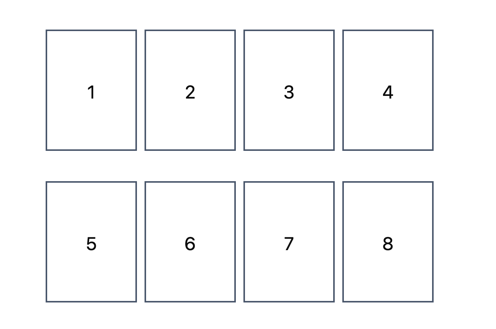

# Navigation - Vue Router

**Vue Router** is the official routing library for Vue.js. It enables the creation of Single Page Applications (SPAs) with seamless navigation between different components without reloading the browser. At its core, routes act as maps that associate URL paths with specific components.

To manage and render the navigation, Vue Router relies on a central configuration file and two core components:

* Main Configuration File (`router/index.js`): Defines the routing table, where application routes are declared and mapped to their corresponding components.

* `<RouterView/>`: Defines the placeholder in the DOM where the component for the current route will be dynamically injected.

* `<RouterLink/>`: Allows you to specify a destination and navigate to the desired route declaratively (though navigation can also be handled programmatically).


8. Define the application's routes in the `router/index.js` file. Create three routes: one for the Home Page, one for the Single Player Game Page, and one for the About Page.

    1. Import the components: Import the required components (HomePage, SinglePlayerGamePage, and AboutPage) into the routing configuration file.
        ```javascript
        // ...
        import HomePage from '@/pages/home/HomePage.vue'
        import SinglePlayerGamePage from '@/pages/game/SinglePlayerGamePage.vue'
        import AboutPage from '@/pages/about/AboutPage.vue'
        ```

    2. Define the routes: Configure the routes array to map each URL path to its corresponding component.
        ```javascript
        // ...
        routes: [
            {
            path: '/',
            name: 'home',
            component: HomePage,
            },
            {
            path: '/games',
            children: [
                {
                path: 'singleplayer',
                name: 'singleplayer',
                component: SinglePlayerGamePage,
                },
            ],
            },
            {
            path: '/about',
            name: 'about',
            component: AboutPage,
            },
        ],
        ```

    3. Analyze the routes array, which contains the route definitions (the mappings between URL paths and components). Each route object can include the following properties:

        * `path`: The URL path segment for the route.
        * `name` (optional): A unique identifier for the route, allowing you to navigate programmatically or declaratively by name rather than by path.
        * `component`: The component to render when the route is matched. This is typically mandatory, but a route can be defined without a component if it includes nested children (see the games route example above).
        * `children` (optional): An array of nested child routes. If the parent route has an associated component, that component must include its own <RouterView/> to render the children. If the parent has no component, the children will render in the current <RouterView/> (usually in App.vue), and the parent's path simply acts as a prefix for the URLs of its children.        

9. Update the application's main template by designating `App.vue` as the root component, and modify its template code to include a navigation menu. 

    1. Modify the `main.js` file to restore the `App.vue` component as the application's root component. Also, ensure that `main.js` file imports the necessary router dependencies and initializes the router. 

    2. Update the `App.vue` component code to the following:

        ```vue
        <template>
        <nav class="max-w-full p-5 flex flex-row justify-between align-middle">
            <div class="align-middle text-xl">
            <!-- TODO: Replace with router link to Home page -->
            <a href="/"> 🧠 Memory Game </a>
            </div>
            <NavigationMenu>
            <NavigationMenuList class="justify-around gap-20">
                <NavigationMenuItem>
                <NavigationMenuTrigger>Games</NavigationMenuTrigger>
                <NavigationMenuContent>
                    <li>
                    <NavigationMenuLink as-child>
                        <!-- TODO: Replace with router link to Single Player Game page -->
                        SinglePlayer Game
                    </NavigationMenuLink>
                    <NavigationMenuLink>
                        MultiPlayer Game
                    </NavigationMenuLink>
                    </li>
                </NavigationMenuContent>
                </NavigationMenuItem>
                <NavigationMenuItem>
                <NavigationMenuLink>
                    <!-- TODO: Replace with router link to About page -->
                    About
                </NavigationMenuLink>
                </NavigationMenuItem>
            </NavigationMenuList>
            </NavigationMenu>
        </nav>
        <div>
            <main>
            <!-- TODO: Add Router View -->
            </main>
        </div>
        </template>

        <script setup>
        import {
        NavigationMenu,
        NavigationMenuContent,
        NavigationMenuItem,
        NavigationMenuLink,
        NavigationMenuList,
        NavigationMenuTrigger,
        } from '@/components/ui/navigation-menu'
        import { RouterLink, RouterView } from 'vue-router'
        </script>

        <style></style>
        ```        

    3. Look for the `TODO` comments and replace them with `<RouterView>` and `<RouterLink>` components, ensuring you use the correct attributes and proper configuration. 
    
        *Note:* To specify the target route, use the route name instead of the path. Refer to the [Vue Router Documentation](https://router.vuejs.org/) and the [Named Routes Guide](https://router.vuejs.org/guide/essentials/named-routes.html) for more details on how to use these components.

    4. Test the application by running it and navigating through the different routes using the navigation menu. Ensure that the correct components are displayed for each route and that the navigation works as expected.

    5. Test the application by changing the URL in your browser:
        * [http://localhost:5173/](http://localhost:5173/) - Home Page
        * [http://localhost:5173/games/singleplayer](http://localhost:5173/games/singleplayer) - Single Player Game Page
        * [http://localhost:5173/about](http://localhost:5173/about) - About Page    

10. Replace the content of the `HomePage` component with the following:

    ```vue
    <template>
        <div class="flex flex-row justify-center items-stretch gap-5 mt-10">
            <Card class="w-full max-w-md">
                <CardHeader>
                    <CardTitle class="text-3xl font-bold text-center">
                        Single Player
                    </CardTitle>
                    <CardDescription class="text-center">
                        Test your memory by finding matching pairs!
                    </CardDescription>
                </CardHeader>
                <CardContent class="space-y-6">
                    <div class="space-y-2">
                        <label class="text-sm font-medium">Choose Difficulty</label>
                        <div class="grid grid-cols-3 gap-2">
                            <!-- TODO: Add Difficulty Choice functionality -->
                        </div>
                    </div>
                    <div class="space-y-2">
                        <label class="text-sm font-medium">High Scores (local)</label>
                        <!-- TODO: Add High Scores functionality -->
                    </div>
                    <div class="flex justify-center">
                        <Button size="lg" variant="secondary" class="hover:bg-purple-500 hover:text-slate-200">
                            Start Game
                        </Button>
                    </div>
                </CardContent>
            </Card>
            <Card class="w-full max-w-md">
                <CardHeader>
                    <CardTitle class="text-3xl font-bold text-center">
                        MultiPlayer
                    </CardTitle>
                    <CardDescription class="text-center">
                        Comming Soon!!
                    </CardDescription>
                </CardHeader>
                <CardContent class="space-y-6">

                </CardContent>
            </Card>
        </div>
    </template>

    <script setup>
    import { Button } from '@/components/ui/button'
    import {
        Card,
        CardContent,
        CardDescription,
        CardHeader,
        CardTitle
    } from '@/components/ui/card'

    </script>
    ```
    
    1. Test the application by running it and navigating to the Home Page. Ensure that the layout and components are displayed correctly, as presented here:
            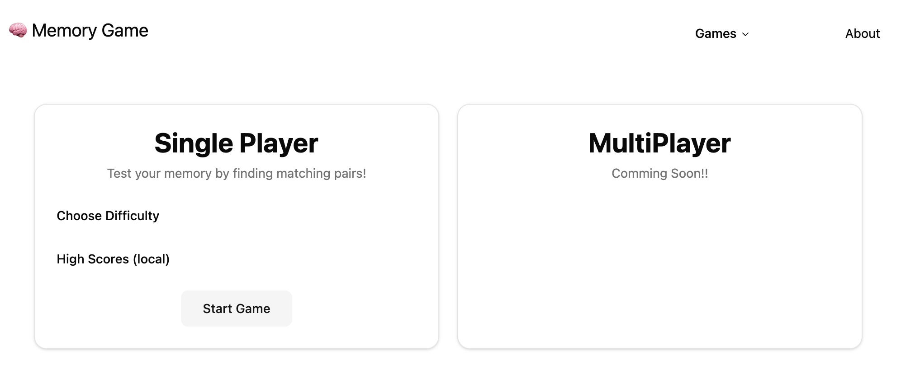

11. Ensure that clicking the "Start Game" button navigates the user to the Single Player Game Page. To achieve this, implement **programmatic navigation** using the `useRouter` composable from Vue Router. For more details on useRouter, check the [Vue Router and the Composition API Documentation](https://router.vuejs.org/guide/advanced/composition-api.html), and for more details about navigating programmatically, refer to the [Programmatic Navigation Documentation](https://router.vuejs.org/guide/essentials/navigation.html#programmatic-navigation). 

    *Note:* Create a constant named `startSinglePlayerGame` with the function that will handle the navigation to the Single Player Game Page. Then, bind this function to the "Start Game" button's click event using the `@click` directive.


    
# Global State - Pinia

**Pinia** is the official state management library for Vue.js. It enables you to share a reactive state across multiple components throughout your application, eliminating the need for complex prop drilling. At its core, Pinia stores act as centralized data containers that hold application state, computed values, and business logic.

To manage and access this global state, Pinia relies on a central plugin initialization and modular Pinia store files:

* Main Plugin Initialization (`main.js`): Where Pinia is instantiated using createPinia() and registered with the Vue application instance.

* Stores (`defineStore()`): The modular configuration files where individual Pinia stores define state, getters, and actions.

* Store Consumption (Composition API): Functions and helpers that allow components to reactively read and update Pinia stores.

Check the [Pinia Documentation](https://pinia.vuejs.org/) for more details on how to use Pinia in your Vue.js applications.

12. Ensure that Pinia is instancieted and registered in the `main.js`file.

    ```javascript
    // ....
    import { createPinia } from 'pinia'
    // ....
    app.use(createPinia())
    // ....
    ```


13. Create a Pinia store named `game` in the `stores/game.js` file. This store will manage the state of the game, starting with the game difficulty and later expanding to the game logic itself.

    1. Create the store file: Create a new file named `game.js` inside the stores folder.

    2. Define the store: In game.js, import the necessary functions from Pinia and Vue, and define the store using `defineStore()`. Add state properties for `difficulties` (an array containing the available options: 'easy', 'medium', and 'hard', along with their labels and descriptions) and `difficulty` (tracking the currently selected difficulty, set to 'medium' by default).

        ```javascript
        import { defineStore } from 'pinia'
        import { ref } from 'vue'

        export const useGameStore = defineStore('game', () => {
            const difficulties = [
                { value: 'easy', label: 'Easy', description: '4x2 grid' },
                { value: 'medium', label: 'Medium', description: '4x3 grid' },
                { value: 'hard', label: 'Hard', description: '4x4 grid' },
            ]

            const difficulty = ref('medium')

            return {
                difficulties,
                difficulty,
            }
        })
        ```

14. On the Home page we will use the newly created store to dynamically render the difficulty options in the template and the selected difficulty will be updated in the store when a user starts a new game.

    1. Start by importing the `useGameStore` function from the `stores/game.js` file into the **HomePage** component. Then, obtaining the store instance by executing the imported function.
        ```javascript
        // ...
        import { useGameStore } from '@/stores/game'
        // ...
        const gameStore = useGameStore()
        // ...
        ```
    2. Create a reactive variable called `selectedDifficulty` with an initial value of 'medium' using the `ref()` function. This variable tracks the user's selected difficulty option within the HomePage component.
    
        *Note:* `selectedDifficulty` is a local state used strictly to manage the user's temporary UI selection before starting a game. It is kept separate from the global store because the official game difficulty is only updated when the user clicks the "Start Game" button.

    3. Use the `v-for` directive to render a `<Button>` component for each difficulty option available in the store's `difficulties` array. When clicked, each button should update the local reactive `selectedDifficulty` variable with its corresponding value. Refer to the [List Rendering Documentation](https://vuejs.org/guide/essentials/list.html) for more details on how to use `v-for`.

        Implementation Guidelines:

        * **Placement**: Insert the buttons where the `<!-- TODO: Add Difficulty Choice functionality -->` comment is located.

        * **Classes**: Apply the following Tailwind CSS classes to each button: `flex flex-col py-3 h-16`.

        * **Button Size**: Set the size of each button to small: `<Button size="sm">`.

        * **Button Content**: Use the following structure inside each `<Button>`, replacing the placeholders with actual values from the store's difficulties array:

            ```vue
            <span class="font-semibold">### Dificulty Label ###</span>
            <span class="text-xs opacity-70">### Dificulty Description ###</span>
            ```

        * **Button Variant**: The button's variant should be set to `outline` (`<Button variant="outline">`) when it is not selected, and to `default` (`<Button variant="default">`) when it is selected. You can achieve this by specifying a dynamic attribute binding (for the `variant` attribute) with a JavaScript expression—such as a ternary operator—that evaluates to the appropriate variant name.

        * **Button Click**: Ensure that clicking each button updates the `selectedDifficulty` reactive variable correctly.

    5. Update the code for the `startSinglePlayerGame` function, invoked when the user clicks on the start button, to set the selected difficulty in the store before programaticly navigating to the Single Player Game Page.

    6. Test the application's Home Page and ensure that it possible to select a difficulty. The Home Page should look like this:
        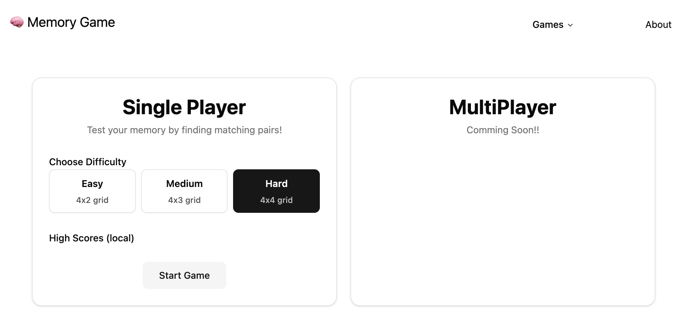 


15. Display the selected difficulty from the game store on the Single Player Game Page. This demonstrates that the store state (`difficulty`) is accessible across all application components and updates correctly.

    To achieve this:

    * Import the `useGameStore` function from the `stores/game.js` file into the **SinglePlayerGamePage** component.

    * Obtain the store instance by calling the imported function.

    * Display the current `difficulty` property (store state) within the component's template.

        ```vue
        <p class="m-auto pt-4 text-center text-md">
            Difficulty Level: <strong>{{ gameStore.difficulty }}</strong>
        </p>
        ```
  
    Single Player Game Page should look like this:

    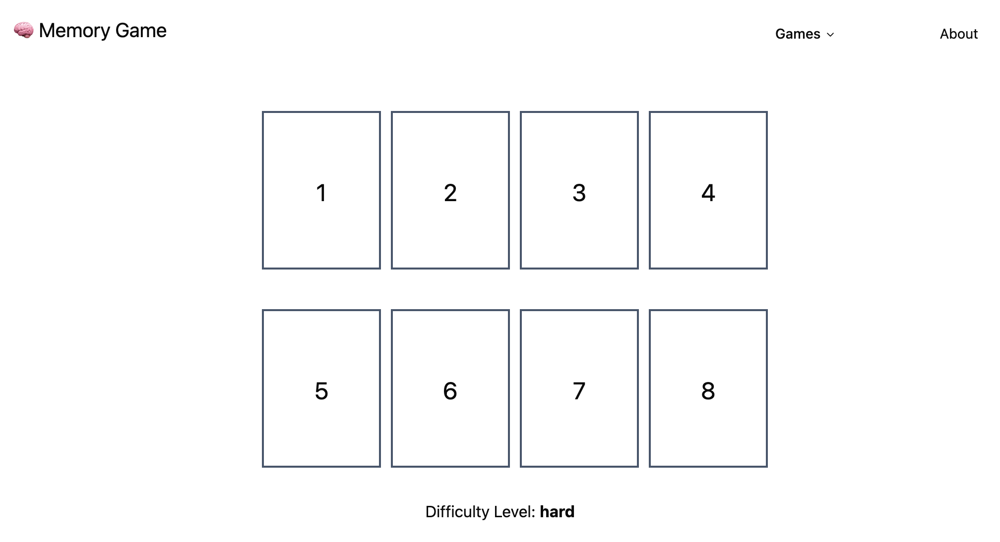 

16. Test the application by running it and navigating to the Home Page. Ensure that the difficulty options are displayed correctly, and that clicking on a difficulty button updates the selectedDifficulty variable as expected. Additionally, verify that clicking the **Start Game** button successfully navigates to the Single Player Game Page while passing the correctly selected difficulty level.

# Memory Game
In this section, we will implement the memory card game logic and functionality. The game consists of a grid of cards that players can flip to reveal their hidden values, with the objective of finding all matching pairs. The core game logic will be provided, but you will need to integrate it into the existing components and ensure that the game interactions behave as expected.

17. Add the provided game logic directly into the **game store**.

    1. Add the following code to the `stores/game.js` file, below the existing state properties. This code defines the game logic, including card management, flipping cards, checking for matches, and determining if the game is complete.

        ```javascript
        // -------------------------------------
        // game logic
        // -------------------------------------

        const options = [1, 2, 3, 4, 5, 6, 7, 8].map((i) => {
            return { face: i, matched: false, flipped: false }
        })

        const cards = ref([])
        const flippedCards = ref([])
        const matchedPairs = ref([])
        const moves = ref(0)

        const isGameComplete = computed(() => {
            if (cards.value.length === 0) return false
            return matchedPairs.value.length === cards.value.length
        })

        const setBoard = () => {
            cards.value = []
            moves.value = 0
            flippedCards.value = []
            matchedPairs.value = []

            let numPairs = 4
            if (difficulty.value === 'medium') numPairs = 6
            if (difficulty.value === 'hard') numPairs = 8

            const boardOptions = options.slice(0, numPairs)

            let idCounter = 0
            boardOptions.forEach((option) => {
            cards.value.push({ id: idCounter++, ...option })
            cards.value.push({ id: idCounter++, ...option })
            })

            for (let i = cards.value.length - 1; i > 0; i--) {
            const j = Math.floor(Math.random() * (i + 1))
            ;[cards.value[i], cards.value[j]] = [cards.value[j], cards.value[i]]
            }
        }

        const flipCard = (card) => {
            if (flippedCards.value.includes(card.id)) return
            if (matchedPairs.value.includes(card.id)) return
            if (flippedCards.value.length >= 2) return

            flippedCards.value.push(card.id)
            card.flipped = true
            if (flippedCards.value.length == 2) {
            checkForMatch()
            }
        }

        const checkForMatch = () => {
            if (flippedCards.value.length !== 2) return

            const [first, second] = flippedCards.value
            const firstCard = cards.value.find((c) => c.id === first)
            const secondCard = cards.value.find((c) => c.id === second)

            moves.value++

            if (firstCard.face === secondCard.face) {
            matchedPairs.value.push(first, second)
            firstCard.matched = true
            secondCard.matched = true
            flippedCards.value = []
            } else {
            setTimeout(() => {
                firstCard.flipped = false
                secondCard.flipped = false
                flippedCards.value = []
            }, 1000)
            }
        }
        ```

    2. Ensure that the required state, computed properties and actions are returned by the game store so they are publicly accessible throughout the application. Update the return statement at the end of the `defineStore()` function in the `stores/game.js` file as follows:
        ```javascript   
        // -----------------------------
        // What the store exposes to components
        // -----------------------------
        return {
            difficulties,
            difficulty,

            // Game logic:
            // state:
            cards,
            moves,
            // computed:
            isGameComplete,
            // actions (functions):
            setBoard,
            flipCard,
            checkForMatch
        }
        ```

18. Update the **Single Player Game Page** to use the `cards` array from the game store instead of a static cards array. To initialize it, execute the `setBoard` action from the game store, which generates a random game board (populating the store's cards array) based on the selected difficulty (also defined in the store).

    Additionally, ensure that the **GameBoard** component accepts a `cards` prop—initialized in the Single Player Game Page by passing the store's cards state—and that the **MemoryCard** `card` prop accepts an Object instead of a Number.

    1. Import the `useGameStore` function from the `stores/game.js` file into the **SinglePlayerGamePage** component, and obtain the store instance by calling it.

    2. Add the **onMounted()** lifecycle hook to the **SinglePlayerGamePage** component. Inside the onMounted() hook, call the `setBoard()` action from the game store to initialize the game board as soon as the **SinglePlayerGamePage** component mounts. Refer to the [Lifecycle Hooks Documentation](https://vuejs.org/guide/essentials/lifecycle.html) for more details on Vue.js lifecycle hooks, including `onMounted`.

    3. Update the **GameBoard** component to accept a `cards` prop passed down from the SinglePlayerGamePage component. Start by deleting the static `cards` array in the **GameBoard** component and replacing it with a `cards` **prop** of type `Array`. Refer to the [Props Documentation](https://vuejs.org/guide/components/props.html) for details about Vue.js props.

    4. The `cards` **prop** defined in the game store is an array of objects, where each object contains four properties: `id`, `face`, `matched`, and `flipped`. This means the v-for directive in the **GameBoard** template must be updated for this new data structure—specifically, using the `id` property for the `key` attribute and passing the card object into the `<MemoryCard/>` component (the **MemoryCard** component template will be updated next to match this structure.)

    5. In the template of the **SinglePlayerGamePage** component, pass the game store's `cards` state as a prop to the `<GameBoard>` component.

    6. Test the application by starting a single-player game. At this point, the Single Player Game page will look like a work in progress:

         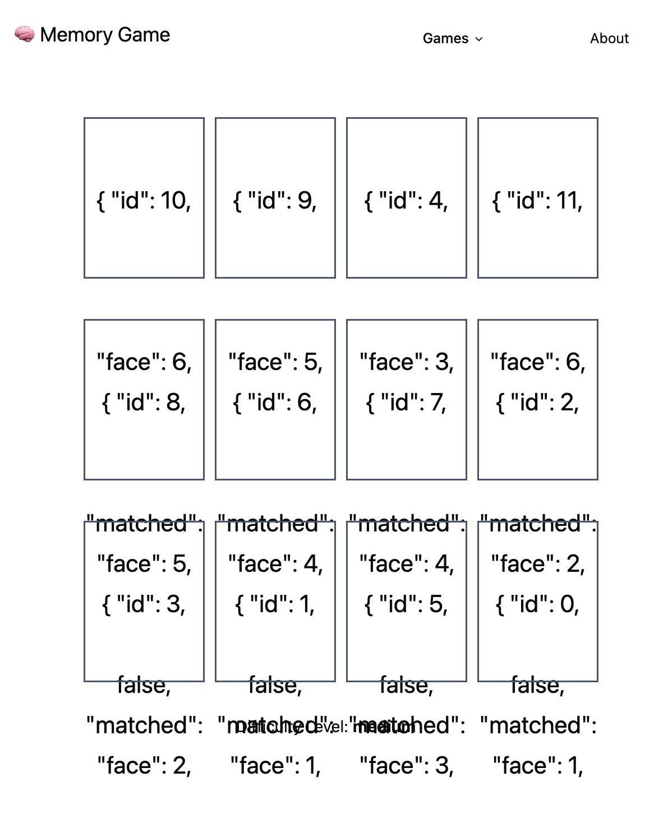 

    7. The content of the cards on the game board does not appear as expected (a single number representing the card's face) because the `card` **prop** of the **MemoryCard** component currently expects a Number, but we are now passing an Object instead. To resolve this, update the **MemoryCard** component by changing the `card` prop's **type** to Object, and then update the component template to display the `card.face` property:

        ```vue
        <template>
            . . . 
            {{ card.face }}
        </template>

        <script setup>
        const props = defineProps({
            card: {
                type: Object,
                required: true
            }
        })
        </script>
        ```

    8. Test the application again by starting a single-player game. The Single Player Game page should now display the expected game board, with each card represented by its face value (a number). The single-player game should look similar to this:

         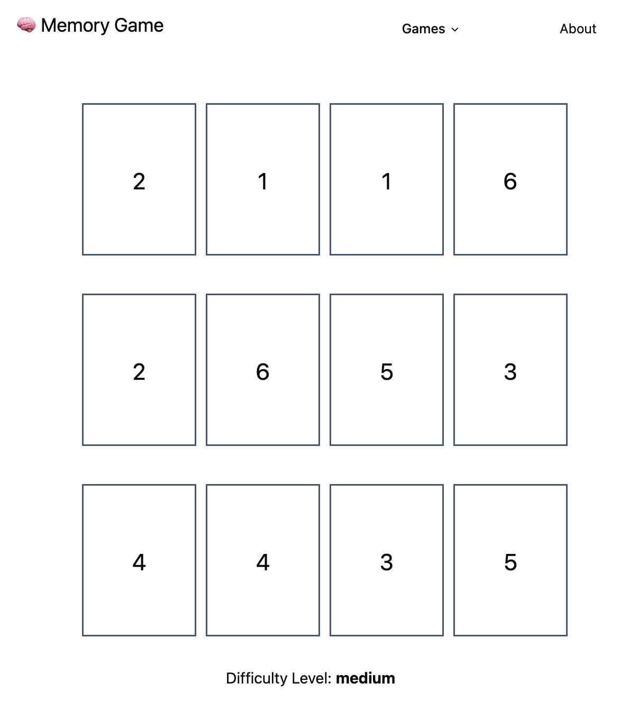 

19. Currently, the **MemoryCard** components only show their face value (a number). In this exercise, we will update the template so the card can also represent its hidden state. Additionally, when a user clicks a card, it will invoke the appropriate game logic action, updating the global state and ultimately — and automatically — refreshing the game board and card visuals.

    1. In the **MemoryCard** component, replace the template section showing the card face (`{{ card.face }}`) with the following code, which displays either a question mark when the card is hidden or its face number when it is flipped:
        ```vue
        <div v-if="!card.flipped" class=" bg-purple-600   hover:bg-violet-400">
            <span class="text-3xl text-white font-bold">?</span>
        </div>
        <div v-else>
            {{ card.face }}
        </div>
        ```

        * The single-player game should look similar to this, as all cards are initially face down: 
        
        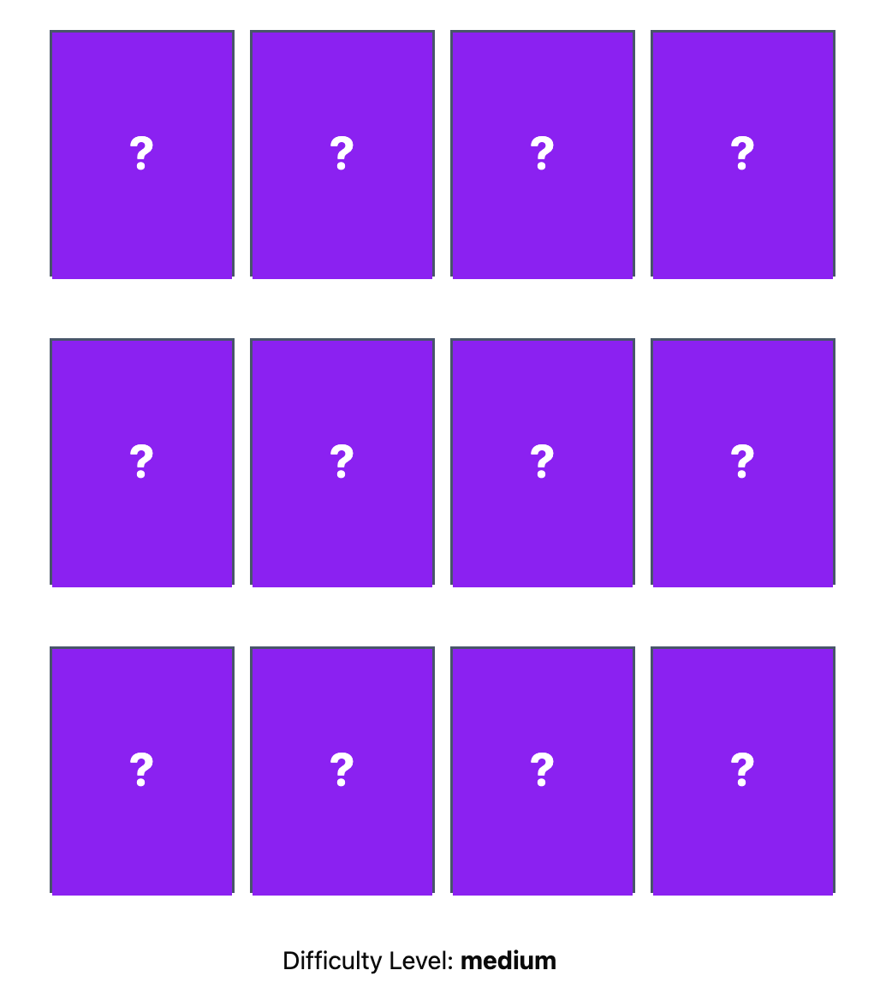 

    2. Still in the **MemoryCard** component, ensure that when the user clicks a playable card, it emits a `play` event to be handled by the parent component (currently the GameBoard component). A card is considered playable only when its face is hidden (i.e., when `flipped` is false). Refer to the [Component Events Documentation](https://vuejs.org/guide/components/events.html) for details on how to define and emit custom events in Vue.js.

        ```vue
        <div class="relative w-30 h-40 leading-40 cursor-pointer
                border-2 border-slate-600 text-2xl text-center" 
                :class="{ 'cursor-not-allowed': card.matched }"
            @click="handleClick">
        ````
        ```javascript 
        const handleClick = () => {
            // if card is playable, emit the event "play"
        }
        ```
    3. In the **GameBoard** component (the parent component of MemoryCard), listen for the `play` event emitted by the MemoryCard component and re-emit it upward to its own parent as a `flipCard` event.
    
    4. In the **SinglePlayerGamePage** component (the parent component of GameBoard), listen for the flipCard event emitted by the GameBoard component and handle it by calling the flipCard action defined in the game store. When this action is called, the game state in the store—including the cards array—updates accordingly, and the visual representation of the cards synchronizes automatically in the GameBoard component.

    5. Open the single-player game page and click on the cards to find all matching pairs. Check that everything is working as expected. Below is an example of the single-player game page during active gameplay (with the "hard" difficulty level):

         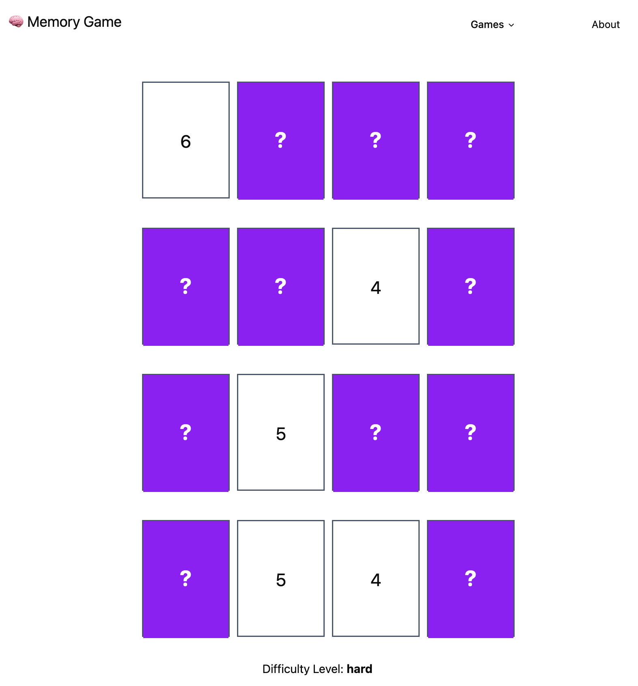 

20. The game is working, but an important detail is missing: the user is not informed when the game ends. We will implement two complementary solutions to solve this. The first solution detects the exact moment the game ends and displays an alert message. The second solution presents a game status message that updates dynamically depending on whether a game is currently in progress or has finished.

    1. In the **SinglePlayerGamePage** component, add a **watch** function that monitors changes to the `isGameCompleted` computed property from the game store. When the game ends (i.e., when `isGameCompleted` becomes true), execute the following code:
        ```javascript
        alert(`Game Completed in ${gameStore.moves} moves`)
        ```
        Refer to the [Vue Watchers Documentation](https://vuejs.org/guide/essentials/watchers.html) for details about Vue.js **watchers**.

    2. Test the application and play a game until completion. An alert message will now be displayed:
         
         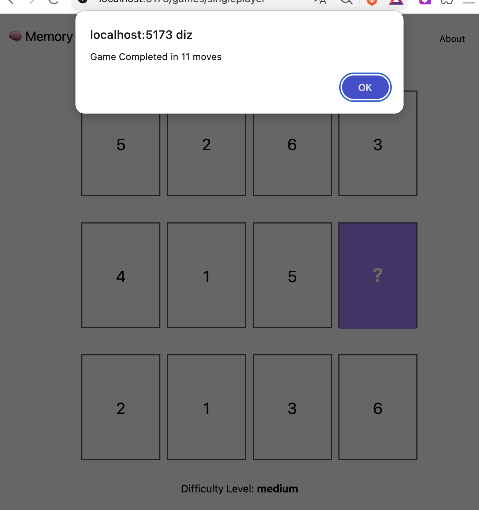 

    3. Add the following section to the **SinglePlayerGamePage** template (before the paragraph with the difficulty level). This will add a dynamic game status message.
        ```vue
        <p v-if="gameStore.isGameComplete" class="pt-4 m-auto text-center text-2xl">Game Ended in 
           <strong>{{ gameStore.moves }} moves</strong></p>
        <p v-else class="pt-4 m-auto text-center text-xl">Game is playing: 
           <strong>move {{ gameStore.moves }}</strong></p>
        ```   
    4. Test the application and play a game. Check if the game status message is correct:
         
         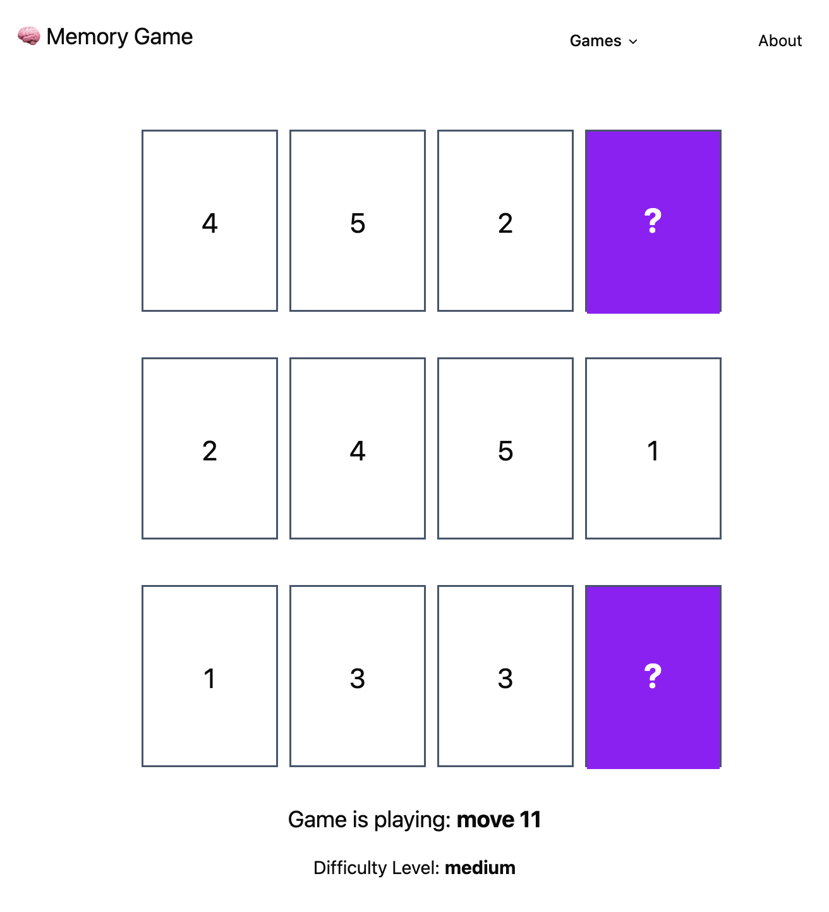 

# Highscores (optional)

21. Implement a mechanism to track the game time and store the top 3 best times (high scores). Display these high scores on the home page. Additionally, ensure that the high scores persist across page refreshes (using session storage, meaning they survive a page refresh but clear when the tab or browser is closed).

    * Below is an example of the home page layout displaying the high scores:
    
    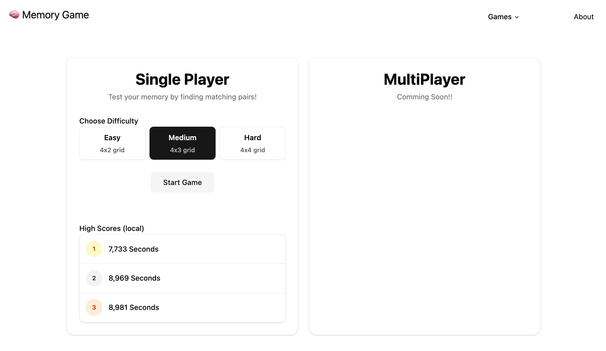 