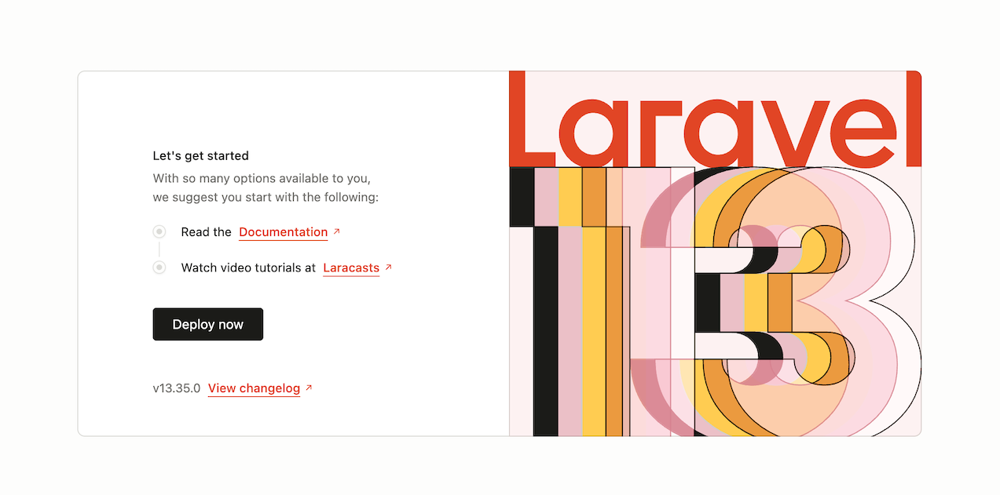
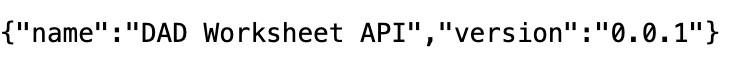
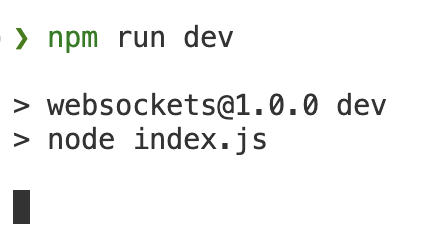
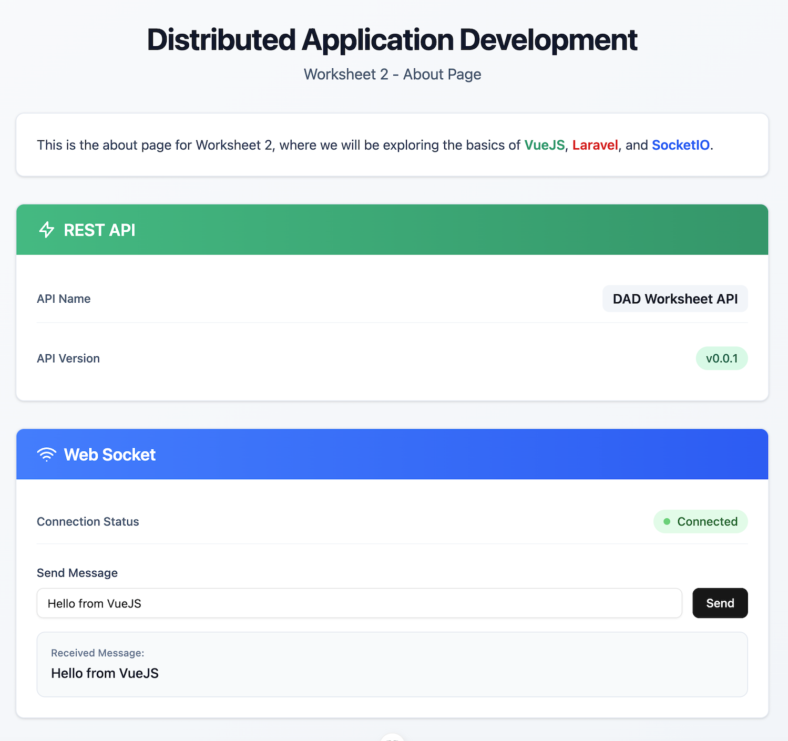

#

# Desenvolvimento de Aplicações Distribuídas

# Initial setup

If you don't have a working version of the base project, you can start by **cloning** the repository "Lab 03 - Memory Game" with the following command: 
````shell
git clone https://apps.dei.estg.ipleiria.pt/gitea/DAD/Lab03-MemoryGame.git
````

The repository does not include the projects' dependencies. You will need to install them manually. Additionally, you must configure the .env file for the API project and recreate the API database.

# API Project (Laravel)

1. From the repository root, install the dependencies for the API project with the following command:
    ````shell
    cd api
    composer install
    ````    
2. Create the `.env` file by copying the contents of `.env.example`:
    ````shell
    cp .env.example .env
    ````

3. Generate the application key with the following command:
    ````shell
    php artisan key:generate
    ````

4. Configure the `.env` file with the correct database credentials (only required if using a database other than SQLite). Then, run the migrations and seeders to create the database structure and initial data using the following command:
    ````shell
    php artisan migrate:fresh --seed
    ````

5. Start the API server with the following command:
    ````shell
    php artisan serve
    ````


6. If everything is set up correctly, the API server should now be running. Open `http://localhost:8000` in your browser to view the following welcome page:
    
    

    Next, open `http://localhost:8000/api/metadata` in your browser to test the API endpoint. It should present the following content (a JSON representation returned by the API):
        

    If you see the content above, it means that the API project is running correctly.


# WebSocket Server Project (Node.js)

7. From the repository root, install the dependencies for the WebSocket server project with the following command:
    ````shell
    cd websockets
    npm install
    ````
8. Start the WebSocket server with the following command:
    ````shell
    npm run dev
    ````
9. If everything is set up correctly, the WebSocket server should now be running - you should see the following in the terminal:
    
    

# Frontend Project (Vue.js)

10. From the repository root, install the dependencies for the Vue.js frontend project with the following command:
    ````shell
    cd frontend
    npm install
    ````
11. Start the Vue.js frontend project with the following command:
    ````shell
    npm run dev
    ````    
12. If everything is set up correctly, the Vue.js frontend project should now be running. Open `http://localhost:5173` in your browser to view the following page:

    

13. Ensure that the REST API is working correctly by checking the API Name and API Version, whose values should be "DAD Worksheet API" and "v0.0.1", respectively.

14. Type a message into the input field and click the "Send" button. You should see the message appear in the "Received Messages" section, indicating that the WebSocket server is working correctly.
